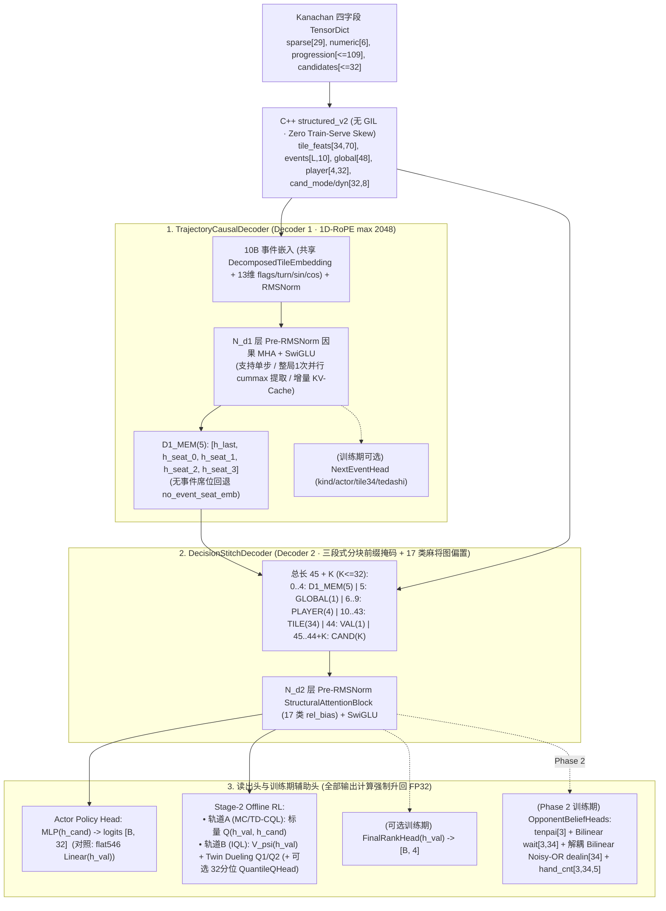

# Structured Dual-Decoder V2 完整架构与工程合同规范（Kanachan 权威自包含版）

> **文档状态**：v1.0 完整冻结规格（立足 `kanachan` 干净基线 `28356fe`，分支 `docs/structured-dual-decoder-v2`）  
> **自包含原则**：本文档完整吸收并统一了 V2/V3 全部已验证的架构、70 维牌特征、10 字节事件流、48/32 维全局与玩家特征、546 动作静态表与 7 模式候选动态特征、拼接式双 Decoder-Only（含整局并行 Teacher Forcing、增量 KV-Cache 与 17 类麻将图结构偏置）、6× 花色置换增强、20 维座位等变 Pure-State GRP 势函数、Stage-2 Offline IQL / QR-DQN / MC-CQL，以及 Phase-2 全视 Belief 头、独立双 Decoder `OracleCriticV2` 与 Stage-3 在线 PPO 防崩塌三大原语；同时逐项定死 `kanachan` C++ 四字段契约的无损推导公式。脱离任何外部仓库即可无歧义独立实现。  
> **实施红线**：本文档所有参数量、吞吐与胜率结论均以目标环境真实实测为准；在通过全部自动化合同测试、RTX 5090 BF16 kernel 实测与同牌山四座轮换配对评测前，现有 `DenseDecisionDecoder + MC-CQL` 正式基线保持独立不变。

---

## 0. 不可违反的核心不变量（Contract Invariants）

1. **信息严格隔离与盲视角推理纯净性（Zero Leakage & Stationary Critic）**：
   - Actor 推理与导出的 `snapshots/model.kanachan` 仅消费当前观察者合法可见的公开信息与己方暗手（即四字段 `sparse, numeric, progression, candidates`）；
   - 对手暗手、活山牌序/分布、未亮里宝牌、对手真实待牌及即时放铳真值**仅允许进入 Phase 2 训练期监督标签（`OpponentBeliefHeads`）或完全独立权重的训练期 `OracleCriticV2`**；
   - Actor 与 `OracleCriticV2` **仅共享原始可观测输入张量，严禁共享任何动态更新的中间隐藏层表示**；导出推理模型时，训练期 `NextEventHead`、`FinalRankHead`、`OpponentBeliefHeads`、IQL $Q/V$ 头与 `OracleCriticV2` 在模块结构上完整剥离，零额外推理参数与延迟。
2. **546 动作空间严格双射与候选上限硬守卫（Exact 546-Action Bijection & `MAX_CANDIDATES = 32`）**：
   - 严格绑定 `kanachan` 原生 546 动作编码（`NUM_TYPES_OF_ACTIONS = 546`，填充码 `546`，见 §2.6），完整保留赤 5、手切/摸切、立直/默听、吃/碰具体消耗牌组合及相对鸣牌来源；
   - 所有候选列表严格按 `global_id ∈ [0, 545]` 升序排列；C++ 适配器与 Python 端强制断言合法候选数 `1 <= K <= 30 <= 32`（超限或无序直接硬报错，严禁静默截断）。
3. **单一物理可见牌真值源（Physical Tile Deduplication）**：
   - 所有可见枚数 $V_t$、未见枚数 $U_t$、壁（Kabe）与扣除可见牌后的真实有效进张（Ukeire）必须消费同一物理去重结构 `VisibleTileCounts`；严禁将河牌与他家吃/碰/大明杠/加杠中的被鸣牌重复计数，强制满足逐牌种守恒 $0 \le H_t + V_t \le 4$。
4. **事件流严格无损与跨局位置表预留（Lossless Event Stream & `MAX_ROPE_LEN = 2048`）**：
   - 本局事件流只追加不截断；Phase 1 忠实解析 `BOS + progression` 全部公开事件（$1 \le L_p \le 109$），Phase 2 可选扩展观察者可见流（含自身 `TSUMO_SELF` / `SELF_PASS`，数学严格上界 $1 \le L_{\text{ev}} \le 214 < 256$）；
   - Decoder 1 的 1D-RoPE 正余弦表预分配至 **`MAX_ROPE_LEN = 2048`**，为后续多小局跨局上下文无缝拼接预留位置空间，无需修改网络权重结构。
5. **零训练-推理偏差（Zero Train-Serve Skew）**：
   - Phase 1 不向模型喂入任何在 `kanachan.simulation.simulate` 四字段推理时无法确定性还原的特征；
   - 训练预取、无状态便携推理与增量 `KVCache` 推理共用同一份 C++ 原生 `structured_v2` 特征代码（强校验 `STRUCTURED_SCHEMA_ID` 与 `ACTION_MANIFEST_SHA256`）。
6. **牌理特征只作输入，不作优化目标**：
   - 向听数、有效进张、默听有役、副露包络与和了打点特征仅作为候选/牌面辅助输入，绝不替代真实对局动作标签或半庄终局顺位回报。
7. **`K == 1` 强制动作步严格隔离（Forced-Step Masking）**：
   - 立直后自动摸切等仅含单一合法候选（`cand_mask.sum(-1) == 1`）的强制步，**完整保留在轨迹演进、奖励累加与价值传播（TD / GAE）中**，但通过 `has_choice = (cand_mask.sum(-1) >= 2)` **严格排除在 BC 交叉熵/Top-1 统计、IQL AWR 策略损失、KL 锚点、CQL 保守正则及 PPO Actor 损失与优势批归一化之外**，防止大量零信息强制步稀释策略梯度。
8. **废弃单步重排，统一端到端双 Decoder 策略与价值表征**：
   - 彻底弃用旧式单步启发式重排；Decoder 2 通过 `[VAL(1)]` 与 `[CAND(K)]` 联合读出策略 Logits $z_k$、状态价值 $V(s)$ 与动作价值 $Q(s, a_k)$，在同一主干上公平对比 MC+CQL 与 IQL+AWR。

---

## 1. 基线状态、迁回 `kanachan` 原因与分阶段实施边界

### 1.1 当前 `kanachan` 基线能力（`28356fe`）

1. **原始雀魂牌谱标注器**：[src/annotation](../../src/annotation/README.md) 原生解析雀魂 WebSocket protobuf 记录，已完整覆盖立直延迟扣棒、抢杠、九种九牌、四风连打、四杠散了、四家立直、双响/三响与包牌结算，直接生成 `source-v3` 四字段样本与半庄终局结果。
2. **原生 C++ 四麻仿真器**：[src/simulation](../../src/simulation/round_state.hpp) 与 [decision_maker.cpp](../../src/simulation/decision_maker.cpp) 提供多线程批量 GPU 推理对局评测入口 `kanachan.simulation.simulate`。
3. **现有 Formal 模型与离线 RL 底座**：`DenseDecisionDecoder` + `GlobalActionHead`（见 [decision-decoder.md](decision-decoder.md)、[decision-features.md](decision-features.md)、[iql/decision-decoder.md](iql/decision-decoder.md)）已跑通流式 BC、`streaming_mc` 全语料 MC+CQL、TD+CQL、IQL/AWR、`dense_final_rank_labels` 及精确断点续训。

### 1.2 为什么迁回 `kanachan` 落地完整 V2 设计

此前在 `RiichiEnv` 推进时暴露出的反复缺陷集中在引擎历史包袱：内部同时并存 `step()`、`apply_mjai_event()`、`apply_log_action()` 三套平行规则状态机，且强制为无物理编号的原始雀魂牌谱分配 `0..135` 唯一物理牌 ID，导致角落规则修改极易引发状态机分叉与重号冲突。

迁回 `kanachan` 后：
- **底层规则与牌谱解析零重写**：直接复用久经实战检验的 `src/annotation` 与 `src/simulation`；
- **完整保留 V2 全部算法与结构资产**：将 V2 的 70 维牌面表示、10 字节事件流、7 模式候选路由、拼接式双 Decoder-Only、17 类麻将图偏置、整局并行 Teacher Forcing、6× 花色置换、20 维 Pure-State GRP、Offline IQL / QR-DQN、训练期 Bilinear Noisy-OR Belief 头及 Stage-3 `OracleCriticV2` 防崩塌体系 100% 无损移植到 `kanachan` 上。

### 1.3 两阶段渐进实施边界

- **Phase 1（零重标，100% 兼容现有 `source-v3` 四字段文件与原生 `simulate`）**：
  - 不改动磁盘 `source-v3` TSV 数据格式，也不改动 `DecisionMaker` 的四字段 TensorDict 接口 `(sparse, numeric, progression, candidates)`；
  - 在 `src/features` 中实现纯 C++（零 GIL）`structured_v2` 适配器，从四字段确定性还原五组结构化张量；此阶段跨局历史通道 `player_feats[20..31]` 恒置 `0.0`，不接入训练期全视头。
- **Phase 2（扩展 `src/annotation` 训练期全视标签与可选跨局/自博弈扩展，推理仍零泄漏）**：
  - 利用 [Annotation](../../src/annotation/annotation.cpp) 构造时已持有的 `std::array<PlayerState, 4u>` 导出独立的训练期 sidecar 标签（三家听牌、34 维待牌、34 维即时放铳真值、暗手张数分布，以及可选 `OracleCriticV2` 所需的全知牌山/暗手特征）；
  - 开启 Stage-1 `OpponentBeliefHeads` 联合辅助监督；按需解锁可选 Stage-3 独立双 Decoder `OracleCriticV2` 在线自博弈微调。导出 `snapshots/model.kanachan` 时完整裁剪所有训练期专有分支。

---

## 2. `kanachan` 四字段契约与 C++ `structured_v2` 逐维冻结规格

本节所有编码常量均严格对齐 [constants.py](../constants.py)、[player_state.cpp](../../src/annotation/player_state.cpp)、[round_progress.cpp](../../src/annotation/round_progress.cpp)、[annotation.cpp](../../src/annotation/annotation.cpp)、[utility.hpp](../../src/annotation/utility.hpp) 与 [shoupai.cpp](../../src/simulation/shoupai.cpp)。

### 2.1 `kanachan` 四字段精确二进制/整数编码真值表

#### A. 牌编码约定（`tile37`、`base34`、`OFFSETS_136`）
- **`tile37 ∈ [0, 36]`**（无牌占位符统一记为 `37 = TILE37_NONE`）：
  - 万子：`0`=赤5m，`1..9`=1m..9m（普5m=`5`）；
  - 筒子：`10`=赤5p，`11..19`=1p..9p（普5p=`15`）；
  - 索子：`20`=赤5s，`21..29`=1s..9s（普5s=`25`）；
  - 字牌：`30..36`=东、南、西、北、白、发、中。
- **`base34 ∈ [0, 33]`**（空牌位记为 `34 = NULL_TILE_IDX`）：
  - 映射函数：`tile37 < 30 ? (tile37 / 10) * 9 + (tile37 % 10 == 0 ? 4 : tile37 % 10 - 1) : tile37 - 3`；
  - `0..8`=1m..9m，`9..17`=1p..9p，`18..26`=1s..9s，`27..33`=东南西北白发中。
- **暗手 `OFFSETS_136`（长度 37）**：
  `(0, 1, 5, 9, 13, 17, 20, 24, 28, 32, 36, 37, 41, 45, 49, 53, 56, 60, 64, 68, 72, 73, 77, 81, 85, 89, 92, 96, 100, 104, 108, 112, 116, 120, 124, 128, 132)`。

#### B. 四字段张量输入布局
| 字段 | 形状与范围 | Padding | 精确编码定义 |
| :--- | :--- | :---: | :--- |
| `sparse` | `int32[B, 29]`，`0..509` | `510` | `[0]` `room (0..4: 铜/银/金/玉/王座)`；`[1]` `num_rounds_type (5=东风, 6=半庄)`；`[2..5]` 绝对席位 `0..3` 段位 `level (+7/+23/+39/+55，各 0..15)`；`[6]` 观察者绝对席位 `71 + seat (71..74)`；`[7]` 场风 `75 + chang (75..77: 东/南/西)`；`[8]` 局号/庄家绝对席位 `78 + ju (78..81)`；`[9]` 活山剩余摸牌数 `82 + left_tile_count (82..151，对应 0..69)`；`[10..]` 1..5 枚已亮宝牌指示牌 `152 + slot*37 + tile37 (152..336)`、暗手物理槽 `337 + idx136 (337..472)`、可选自摸牌 `473 + zimo_tile37 (473..509)` |
| `numeric` | `int32[B, 6]` | 无 | `[ben (本场), liqibang (场上供托棒数), score[0], score[1], score[2], score[3]]`（按**绝对起家席位 `0..3`** 排列，单位为原始点棒，如 `25000`） |
| `progression` | `int32[B, L_p]`，`1 <= L_p <= 109` | `2165` | `[0] = 0`（局初 BOS）；`1..4` 预留未启用；`5..596` `DAHAI = 5 + 148*seat + 4*tile37 + 2*moqie + liqi`；`597..956` `CHI = 597 + 90*seat + chi_encode`；`957..1436` `PON = 957 + 120*seat + 40*rel_from + peng_encode`；`1437..1880` `DAIMINKAN = 1437 + 111*seat + 37*rel_from + tile37`；`1881..2016` `ANKAN = 1881 + 34*seat + base34`；`2017..2164` `KAKAN = 2017 + 37*seat + tile37` |
| `candidates` | `int32[B, 32]`，`0..545` | `546` | 严格升序合法动作：`0..147` `DISCARD (4*tile37 + 2*moqie + liqi)`；`148..181` `ANKAN (base34)`；`182..218` `KAKAN (tile37)`；`219` `TSUMO`；`220` `KYUSHU_KYUHAI`；`221` `SKIP/PASS`；`222..311` `CHI (chi_encode)`；`312..431` `PON (40*rel_from + peng_encode)`；`432..542` `DAIMINKAN (37*rel_from + tile37)`；`543..545` `RON (rel_from)`。其中 `rel_from ∈ {0=下家, 1=对家, 2=上家}` 对应相对席位 `source_rel = rel_from + 1 ∈ {1, 2, 3}` |

> **关于 `room` 与四家 `level` 的防偏差处理策略（显式契约）**：`sparse[0]` 与 `sparse[2..5]` 编码了人类牌谱的房间与段位。若直接喂入策略主干，模型会拟合低段位人类次优习惯，且在 `simulate` 对局中受伪造段位影响。因此 V2 默认配置 **`include_room_level: bool = False`**——仅读取 `sparse[1]`（`is_tonpuusen = (sparse[1] == 5)`），**彻底忽略 `room` 与 `level`**，使策略专注于纯粹博弈状态。

#### C. `source-v3` 磁盘 TSV 列格式与单步 / 整局轨迹读取规则
- **8 列 TSV 行格式**（见 [data_iterator.py](core/bc/data_iterator.py) 与 [annotation.cpp](../../src/annotation/annotation.cpp#L745-L783)）：
  `uuid \t sparse \t numeric \t progression \t candidates \t action \t round_summary \t results`
  - `action` 为选定动作在 `candidates` 中的**槽位下标 `0..31`**（`int32`），对应全局动作 ID 为 `chosen_global_id = candidates[action]`；
  - `results` 为 14 个逗号分隔整数：`round_delta_scores[0..3], benchang, num_liqibangs, post_round_scores[0..3], final_game_scores[0..3]`。
- **单步模式 vs 整局并行模式的数据源要求**：
  - 已被全局行打乱（shuffled）的 `train.bc.tsv` 直接走单步模式（可配合按 `len(progression)` 分桶的 `LengthBucketBatchSampler`）；
  - 整局并行 Teacher Forcing（`forward_round_trajectory`）、20 维 `PureStateGRP` 训练以及 Stage-2 Offline IQL / `streaming_mc` **必须读取未打乱的完整 `source-v3` 半庄标注流**：`parse_bc_rounds()` 默认启用 `allow_incomplete=False, allow_unlabeled=False`，按 UUID 隔离局界、强制同一 UUID 跨 4 席 `final_game_scores` 与同物理小局 `round_summary/results` 一致，按 `(pr_len, -left_tiles, is_own_turn)` 规范时序拒绝重复步与分叉/非前缀历史，并校验首局 `(0,0,0)`、庄家起手 `(0,)`、全非立直/非模切动作逐步覆盖、胜局和牌/荒牌残张结尾与终局（东4/南4或击飞）完整性（仅当显式测试合成片段时才允许传入 `allow_incomplete=True`）；按 `(uuid, observer_seat, chang, ju, ben)` 切分小局块后取最长 `progression` 作为 `round_events` 全集，各决策步的事件长度即为 `decision_event_len[t]`。

---

### 2.2 从四字段确定性还原完整局内状态的数学规则（零猜测、零泄漏）

在 C++ `structured_v2` 适配器中，按以下 6 条确定性规则单遍回放 `(sparse, numeric, progression, candidates)`：

1. **单一物理可见牌计数（`VisibleTileCounts`）**：
   - 对 37 种牌分别统计观察者暗手（含 `zimo_pai`）`hand37[37]` 与全局已公开非暗手牌 `public37[37]`：
     - 宝牌指示牌：`public37[indicator37] += 1`，同时按 `1→2→…→9→1 / 东→南→西→北→东 / 白→发→中→白` 累加常态宝牌表 `dora_count34[target_base34] += 1`；
     - `progression` 遍历：
       - `DAHAI(..., tile37)`：`public37[tile37] += 1`（记录进该席位河牌；即便后续被他家鸣走也**只在此处计 1 次**）；
       - `CHI(owner, chi_encode)`：查 [shoupai.cpp](../../src/simulation/shoupai.cpp#L41-L132) `chi_encode_[chi_encode]` 的前两项消耗牌 `(c0, c1)`，执行 `public37[c0] += 1; public37[c1] += 1`（第 3 项被吃牌已在上一条 `DAHAI` 计入，不重复计）；
       - `PON(owner, rel_from, peng_encode)`：查 `peng_encode_[peng_encode]` 的前两项消耗牌 `(c0, c1)`，执行 `public37[c0] += 1; public37[c1] += 1`；
       - `DAIMINKAN(owner, rel_from, called37)`：该 `base34` 全部 4 张物理牌均已公开，将其余 3 张（扣除 `called37` 本身）补入 `public37`；
       - `ANKAN(owner, base34)`：将该 `base34` 全部 4 张物理牌（数牌 5 含 1 张赤 5 + 3 张普 5）计入 `public37`（若 `owner == seat`，暗杠牌已不在 `sparse` 暗手中，故不冲突）；
       - `KAKAN(owner, tile37)`：仅新增 `public37[tile37] += 1`（原 `PON` 的 3 张已计过）。
   - 汇总 `base34` 计数：$H_t = \sum_{\text{b34}(x)=t} \text{hand37}[x]$，$V_t = \sum_{\text{b34}(x)=t} \text{public37}[x]$，$U_t = 4 - H_t - V_t$；赤 5 未见标记 `red5_unseen[s] = (hand37[10*s] + public37[10*s] == 0)`（$s \in \{0,1,2\}$）。
   - **硬不变量**：强制校验每个 `tile37` 总数不超过物理上限（赤5 $\le 1$，普5 $\le 3$，其余 $\le 4$）且 $0 \le H_t + V_t \le 4$，违背立即抛 `std::invalid_argument`。

2. **当前决策阶段（`DecisionPhase`）与未决触发事件精确判定**：
   - 检查 `candidates`：
     - 若含任一自己回合动作（`< 221`：`DISCARD / ANKAN / KAKAN / TSUMO / KYUSHU`），必为 **`OWN_ACT` (`phase = 0`)**，`trigger_actor_rel = None`；其中若 `zimo_pai` 存在则为摸牌后（含岭上摸牌，可由 `progression` 末条是否为观察者自己的 `DAIMINKAN/ANKAN/KAKAN` 精确判定 `is_rinshan = True`），若 `zimo_pai` 不存在且末条为观察者自己的 `CHI/PON` 则为副露后切牌（可由 `chi_encode_[code][3]` 与被鸣牌 `base34` 直接标出 `kuikae_forbidden`）；
     - 否则必含 `SKIP (221)`，处于他家动作响应窗口，考察 `progression` 最后一条事件 `ev_last`：
       - `ev_last` 为他家 `DAHAI` $\implies$ **`DISCARD_RESP` (`phase = 1`)**，触发牌为 `ev_last.tile37`（**未决舍牌**，尚未安全落地），`trigger_actor_rel = (ev_last.seat + 4 - seat) % 4 ∈ {1, 2, 3}`；
       - `ev_last` 为他家 `KAKAN` $\implies$ **`KAKAN_RESP` (`phase = 2`)**（抢加杠荣和窗口，`is_chankan = True`），触发牌为 `ev_last.tile37`，`trigger_actor_rel = (ev_last.seat + 4 - seat) % 4`；
       - `ev_last` 为他家 `ANKAN` $\implies$ **`ANKAN_RESP` (`phase = 3`)**（国士无双抢暗杠窗口，`is_chankan = True`），触发牌为 `_tile37(ev_last.base34)`，`trigger_actor_rel = (ev_last.seat + 4 - seat) % 4`。

3. **立直成立、双立直、一发、立直巡目与庄家配牌首打归一化**：
   - **庄家配牌首打 `moqie` 零偏差归一化**：在原始雀魂 protobuf 中，庄家第一巡首打偶有 `record.moqie() == true` 并原样写入 [round_progress.cpp](../../src/annotation/round_progress.cpp#L43) 的 `progression[1]`，而原生模拟器 [shoupai.cpp](../../src/simulation/shoupai.cpp#L870) 对庄家第一打（`zhuangjia_first_dapai`）恒固定输出 `moqie = 0`（手切）。因此 `structured_v2` 解析 `progression[1]` 时，若该事件为庄家 `ju` 的 `DAHAI`（此前无任何副露/杠），**强制将其 `moqie` 归一化为 `0`（手切）**，同步作用于 `events[1].flags`、`tile_feats` 的 `opp_last_discard_tedashi` 与 `player_feats[19]` 的近 6 巡手切率；
   - 在雀魂规则中，立直宣言牌被 `CHI / PON / DAIMINKAN` 鸣走**立直依然成立**（仅被 `RON` 和牌才作废，而本局仍在继续说明此前所有历史 `DAHAI(..., liqi=1)` 均未被 `RON`）；
   - **唯一需要注意的时序边界**：若当前正处于 `DISCARD_RESP` 且最后一条事件 `ev_last` 恰好是某对手的 `DAHAI(..., liqi=1)`，此时该立直尚处于未结算响应窗口（`numeric` 中该家尚未扣 `1000` 点、`liqibang` 尚未 `+1`）。定义：
     - 对手已公开宣告立直：`riichi_declared[p] = True`（含 `ev_last` 宣告立直者，因其立直宣言已公开）；
     - 双立直 `double_riichi_declared[p]`：该家首次 `DAHAI` 即带 `liqi=1`，且在该事件之前 `progression` 中不存在任何 `CHI / PON / DAIMINKAN / ANKAN / KAKAN`；
     - 一发有效 `ippatsu_active[p]`：该家宣告 `liqi=1` 之后至当前时刻（不含 `ev_last` 若 `ev_last` 本身即为该立直宣言），中间未出现任何 `CHI / PON / DAIMINKAN / ANKAN / KAKAN`，且未再次出现该家自己的 `DAHAI`；
     - 立直巡目 `riichi_turn_index[p]`：该家宣告立直时其自身河牌的序号（`0`-based，归一化 `/ 24.0`）。

4. **合法待牌集合 $W$（严格区分“纯虚听”与“空听 Karaten”）及无 `SELF_PASS` 流下的三类振听还原定理**：
   - **合法待牌集合精确公式**：对观察者 `3k+1` 暗手计数 $h_{\text{closed}}[34]$ 与己方已公开副露/暗杠计数 $M_{\text{self}}[34]$，定义：
     $$W(h_{\text{closed}}, M_{\text{self}}) = \Big\{ w \in \{0..33\} \;\Big|\; h_{\text{closed}}[w] + M_{\text{self}}[w] < 4 \;\land\; \operatorname{Nyanten}(h_{\text{closed}} + e_w) == 0 \Big\}$$
     - **纯虚听（非听牌）**：若某牌种 $w$ 的全部 4 张物理牌已在**己方暗手 + 己方副露/杠**中（$h_{\text{closed}}[w] + M_{\text{self}}[w] == 4$，如己方已碰 `111m` 后单骑第 4 张 `1m`），则 $w \notin W$；若因此导致 $W = \varnothing$，则不构成听牌（`is_tenpai = 0`，修正向听 $s = 1, u = 0$）；
     - **空听 Karaten（合法听牌！）**：若 $h_{\text{closed}}[w] + M_{\text{self}}[w] < 4$，即便其余副本已在河牌/他家副露/宝牌指示牌中全部现身使得未见枚数 $U_w = 0$，在雀魂与 `kanachan` 规则下**仍属于合法听牌**（可立直、流局计听牌，`is_tenpai = 1, s = 0`，仅有效进张 $u = \sum_{w \in W} U_w = 0$），**严禁把桌显空听误判为向听 1**！
   - 基于上述 $W$，三类振听（`FuritenState`）无损还原如下：
     - **舍牌振听（`permanent`）**：观察者本局历史全部 `DAHAI`（含被他家鸣走的牌）中存在 `base34 ∈ W`；
     - **立直振听（`riichi`）**：若观察者已立直，自观察者 `DAHAI(..., liqi=1)` 事件**之后**，在 `progression` 中除当前未决 `ev_last`（当 `phase != OWN_ACT` 时）以外的**任何已落地 `DAHAI`**（无论哪一家切出、无论是否被吃碰杠）只要其 `base34 ∈ W`（或抢杠事件牌 `∈ W`），由于本局未结束说明观察者当时未荣和/自摸，且立直后暗手结构（除不改变待牌的暗杠外）固定不变，故必触发永久 `riichi_furiten = True`；
     - **同巡振听（`temporary`）**：仅在观察者未立直且 `W` 非空时考察。定位 `progression` 中观察者自己最后一次行动事件下标 $idx_{\text{self}}$（`DAHAI / CHI / PON / DAIMINKAN / ANKAN / KAKAN`，若尚无自身事件则为 `0`）：
       - 在 `OWN_ACT` 阶段：若观察者刚完成摸牌（`zimo_pai` 存在），摸牌动作本身按日麻规则已自动解除同巡振听（`temporary = False`）；若刚完成 `CHI/PON`（无 `zimo_pai`），后续动作必为切牌，切牌后亦立即解除 `temporary`；
       - 在 `*_RESP` 阶段：凡在区间 $(idx_{\text{self}}, L_p - 1)$ 内（**显式排除末条当前未决触发事件 $L_p - 1$**）出现的他家 `DAHAI`（或可抢杠的 `KAKAN`/`ANKAN`），观察者当时的 13 张手牌与当前手牌**完全相同**且本局仍在继续，证明观察者必定跳过了该牌；若其中存在 `base34 ∈ W`，则 `temporary = True`（且若 `candidates` 中不含 `RON` 亦可交叉印证）。

5. **大三元 / 大四喜包牌（Pao）责任家确定性追踪**（严格对齐 [round_state.cpp](../../src/simulation/round_state.cpp#L540-L689) `checkDaSanyuanPao_` / `checkDaSixiPao_`）：
   - 遍历 `progression` 统计同一玩家已成型的三元牌刻杠数（含 `PON`、`DAIMINKAN` 与 `ANKAN`）或四风牌刻杠数（含 `PON`、`DAIMINKAN` 与 `ANKAN`）；
   - **包牌触发充要条件**：唯有当凑齐三元的**第 3 组**（或凑齐四风的**第 4 组**）本身是明副露 `PON` 或 `DAIMINKAN` 时，记录该次副露供牌者为 `pao_daisangen_payer`（或 `pao_daisuushii_payer`）——注意若前两组含 `ANKAN` 而第 3 组为 `PON/DAIMINKAN` **依然成立包牌**；反之若第 3/4 组自身是 `ANKAN`（或 `KAKAN` 升级已有碰）则**不成立包牌**。

6. **零 GIL 纯 C++ 雀魂四麻番符与有役评估器（`mjsoul_hand_eval.hpp`）**：
   - **性能红线**：现有模拟器 [shoupai.cpp](../../src/simulation/shoupai.cpp#L240-L244) 的 `calculateHand` 通过 Boost.Python 持 GIL 回调 Python `mahjong` 库，严禁放进训练数据预取与批量特征热路径！
   - Phase 1A 在 `src/features/mjsoul_hand_eval.hpp` 中内置纯 C++20 雀魂四麻算点器（覆盖标准面子手、七对子、国士无双、食断、赤宝、一发/海底/河底/岭上/抢杠/天地和、复合役满、大三元/大四喜包牌、本场与供托结算，以及听牌第五枚虚听规则），全程在 `Py_BEGIN_ALLOW_THREADS` 无 GIL 下运行，并通过单元测试与 `kanachan.simulation.Tool` 在数万随机/边界牌型上 100% 零误差对拍。

---

### 2.3 `tile_feats: [B, 34, 70]` — 完整 70 通道逐列冻结表

数牌专属特征（筋、早外、壁、宝牌邻接）在字牌 `27..33` 上恒填 `0.0`。

#### Group A：己方手牌、宝牌与物理去重可见枚数（19 通道：`0..18`）
| 通道 | 名称 | 精确定义 |
| :--- | :--- | :--- |
| `0..3` | `self_closed_cnt_ge{1,2,3,4}` | 己方暗手（含 `zimo_pai`）该 `base34` 张数 $H_t \ge \{1,2,3,4\}$ 温度计编码 $\in \{0, 1\}$ |
| `4` | `self_closed_has_red5` | 己方暗手（含 `zimo_pai`）持有物理赤 5（仅 `base34 ∈ {4, 13, 22}` 可为 `1.0`） |
| `5..8` | `self_meld_cnt_ge{1,2,3,4}` | 己方全部副露/暗杠中该 `base34` 总张数 $\ge \{1,2,3,4\}$ |
| `9..10` | `self_last_tsumo` / `self_last_tsumo_is_red5` | `OWN_ACT` 存在 `zimo_pai` 时的刚摸入牌及赤 5 标记（庄家配牌首打 `left_tile_count==69`、吃碰后及 `*_RESP` 阶段置 `0.0`） |
| `11` | `kuikae_forbidden` | 当前 `OWN_ACT` 是否因食替规则禁切该 `base34`（直接与合法 `DISCARD` 掩码及 `chi_encode_` 对齐） |
| `12` | `dora_value_norm` | 所有已亮宝牌指示牌对该 `base34` 叠加的常态宝牌翻数 `/ 4.0`（截断至 `[0, 1.25]`） |
| `13` | `red5_unseen` | `VisibleTileCounts.red5_unseen`（仅 `4, 13, 22` 位可为 `1.0`） |
| `14..17` | `unseen_cnt_ge{1,2,3,4}` | 扣除己方暗手与全部去重公开牌后的剩余未见枚数 $U_t \ge \{1,2,3,4\}$ 温度计编码 |
| `18` | `self_discarded_ever` | 己方本局曾切出过该 `base34`（含被他家鸣走的舍牌） |

#### Group B1：3 家对手公开河牌、立直/同巡桌显现物与副露（33 通道：`19..51`，按相对席位 `p ∈ {1=下家, 2=对家, 3=上家}` 各 11 通道，偏移 `off = 19 + (p - 1) * 11`）
| 相对偏移 | 名称 | 精确定义（严格基于 `progression` 公开事件，排除当前未决 `*_RESP` 触发牌） |
| :--- | :--- | :--- |
| `+0` | `opp_own_river_genbutsu` | 对手 `p` 本局曾切出过该牌（含被鸣走舍牌）——100% 确定现物 |
| `+1` | `opp_riichi_declare_tile` | 对手 `p` 立直宣言牌所在 `base34`（未立直或非此牌为 `0.0`） |
| `+2` | `opp_last_discard_tile` | 对手 `p` 已落地河牌中最新一枚舍牌 `base34` |
| `+3` | `opp_suji_one_side` | 数牌中至少一侧关联筋牌属于 `opp_own_river_genbutsu(p) ∪ opp_post_riichi_table_genbutsu(p)` |
| `+4` | `opp_suji_full` | 该数牌所有关联筋方向（`1/2/3` 看 `+3`，`7/8/9` 看 `-3`，`4/5/6` 需 `-3` 与 `+3` 两侧同时满足）均属于上述现物并集 |
| `+5` | `opp_early_discard_shape_hint` | **可开关早巡牌形提示（`enable_early_shape_hint: bool`，严禁视作安全牌或计入筋集合）**：开启时若 `p` 前 6 枚已落地舍牌含同花色 $r_d \in \{2,3,4\}$ 且 $1 \le r < r_d$，或 $r_d \in \{6,7,8\}$ 且 $r_d < r \le 9$，置 `1.0`；关闭时恒 `0.0` |
| `+6` | `opp_discard_recency` | 距 `p` 最近一次切出该牌经过的自身河牌步数 $\Delta t$ 衰减 $\exp(-\Delta t / 6.0)$（未切过为 `0.0`） |
| `+7` | `opp_last_discard_tedashi` | `p` 最近一次切出该牌时是否为手切（`moqie == 0`） |
| `+8` | `opp_meld_cnt_norm` | `p` 已公开副露/杠中该 `base34` 总张数 `/ 4.0` |
| `+9` | `opp_post_riichi_table_genbutsu` | 对手 `p` 立直宣言事件之后，全桌已落地舍牌（显式排除当前 `DISCARD_RESP` 未决触发牌）中出现过的牌 |
| `+10` | `opp_same_turn_table_genbutsu` | 对手 `p` 最近一次自身 `DAHAI` 之后，全桌已落地舍牌中出现过的牌（吃/碰本身不重置同巡振听，唯有 `p` 再次切牌才重置；排除当前未决触发牌） |

#### Group B2：公共壁（Kabe）、宝牌邻接与役牌（8 通道：`52..59`）
| 通道 | 名称 | 精确定义 |
| :--- | :--- | :--- |
| `52` | `kabe_no_chance` | 基于 $K_t = H_t + V_t = 4$ 封死该数牌全部可能两面搭子（如 `2m` 断壁使 `1m` 无两面、`3m` 断壁使 `1m/2m` 无两面等精确枚举） |
| `53` | `kabe_one_chance` | 所有可能两面搭子均至少有一端满足 $H_t + V_t \ge 3$，且不满足 `kabe_no_chance` |
| `54..55` | `dora_adj_dist1` / `dora_adj_dist2` | 同花色内距任一当前常态宝牌数字距离为 `1` / `2` 的数牌标记 |
| `56` | `yakuhai_self_norm` | 对观察者的役牌权重：`0.0`（非役牌）、`0.5`（白/发/中或单场风/单自风）、`1.0`（连风牌） |
| `57..59` | `yakuhai_opp_norm[1..3]` | 对下家、对家、上家各自的役牌权重（`0.0 / 0.5 / 1.0`） |

#### Group C：C++ `Nyanten` 精确向听与有效进张输入特征（10 通道：`60..69`）
- `OWN_ACT` 填充 `60..67`（`68..69` 置 `0.0`）；`*_RESP` 填充 `68..69`（`60..67` 置 `0.0`）。
- 常数 $\ln(61) \approx 4.1108738$。

| 通道 | 名称 | 精确定义 |
| :--- | :--- | :--- |
| `60` | `is_legal_discard` | 当前 `candidates` 中是否存在目标为 `base34 == i` 的合法 `DISCARD` |
| `61` | `discard_shanten_gap_0` | 合法切 `i` 且切后向听数 $s_i$ 等于当前手牌所有合法切牌最小向听 $s^*$ |
| `62` | `discard_shanten_gap_1` | 合法切 `i` 且 $s_i == s^* + 1$ |
| `63` | `discard_post_shanten_norm` | $\min(1.0, \max(0, s_i) / 8.0)$（仅当己方暗手+己方副露已占满 4 枚导致 $W = \varnothing$ 的纯虚听时修正 $s_i = 1, u_i = 0$；桌显见满 4 枚的空听保持 $s_i = 0, u_i = 0$） |
| `64` | `discard_post_ukeire_log` | 扣除全部可见牌后的有效进张枚数 $u_i$：$\min(1.0, \ln(1 + u_i) / \ln(61))$ |
| `65` | `discard_post_ukeire_ratio` | $u_i / \max(1, \max_{j \in \mathcal{D}_{\text{legal}}} u_j)$ |
| `66` | `discard_post_is_tenpai` | 切 `i` 后是否存在至少 1 种合法待牌（遵循雀魂非虚听规则） |
| `67` | `discard_post_is_furiten` | 逐切牌重算：$F_{\text{post}}(i) = \text{riichi\_furiten} \lor \mathbb{1}[W(h \setminus \{i\}) \cap (R_{\text{self}} \cup \{i\}) \neq \varnothing]$ |
| `68` | `resp_is_cur_wait_tile` | `*_RESP` 阶段当前 `3k+1` 手牌听牌且 `i` 为待牌之一 |
| `69` | `resp_is_cur_effective_tile` | `*_RESP` 阶段摸入 `i` 能否使当前 `3k+1` 手牌向听严格减 1 |

---

### 2.4 `events: [B, L_ev, 10]` (`uint8`) — 10 字节结构化事件流契约

采用统一 10 字节紧凑元组，同时兼容 **Phase 1 纯公开流（`1 <= L_ev <= 109`）** 与 **Phase 2 可选观察者可见流（`1 <= L_ev <= 214 < 256`）**：

| 字节 | 字段名 | 取值范围 | Phase 1 从 `sparse + progression` 精确映射规则 |
| :---: | :--- | :---: | :--- |
| `0` | `event_type` | `0..10` | `0=PAD`, `1=DORA(局初BOS位写入初始宝牌指示牌)`, `2=TSUMO_SELF(仅Phase 2)`, `3=DAHAI`, `4=REACH_ACCEPTED(仅Phase 2)`, `5=CHI`, `6=PON`, `7=DAIMINKAN`, `8=ANKAN`, `9=KAKAN`, `10=SELF_PASS(仅Phase 2)` |
| `1` | `actor_rel` | `0..4` | `(event_abs_seat + 4 - observer_seat) % 4 ∈ {0..3}`；索引 `0` 的初始 `DORA` 填 `4 (TABLE)` |
| `2` | `source_rel` | `0..4` | `CHI` 固定为 `(actor_rel + 3) % 4`；`PON/DAIMINKAN` 先由动作方绝对席位还原供牌绝对席位 `from_abs = (event_abs_seat + 1 + rel_from) % 4`，再算 `(from_abs + 4 - observer_seat) % 4`；其余填 `4 (NONE)` |
| `3` | `tile37` | `0..37` | `DORA[0]`: `dora_indicator_0`；`DAHAI/DAIMINKAN/KAKAN`: `tile37`；`CHI`: `chi_encode_[code][2]`；`PON`: `peng_encode_[code][2]`；`ANKAN`: `_tile37(base34) = (base34 < 27 ? (base34 / 9) * 10 + (base34 % 9) + 1 : base34 + 3)`；无牌填 `37` |
| `4` | `consumed0_37` | `0..37` | `CHI/PON`: 查表第 0 张消耗牌 `tile37`（含赤 5）；其余填 `37` |
| `5` | `consumed1_37` | `0..37` | `CHI/PON`: 查表第 1 张消耗牌 `tile37`（含赤 5）；其余填 `37` |
| `6` | `flags` | bitmask | `b0: moqie (tsumogiri)`, `b1: is_riichi_declare`, `b2: is_double_riichi`, `b3: is_rinshan (紧随本人杠后的切牌)`, `b4: involves_red5`（`ev_3/ev_4/ev_5` 含 `{0,10,20}`，**或 `ANKAN/DAIMINKAN` 落在 `base34 ∈ {4,13,22}` 因四枚必含赤 5**） |
| `7` | `sub_mask` | `uint8` | `DORA`: `dora_idx (0)`；Phase 2 `SELF_PASS`: 放弃位掩码 `(chi|pon|kan|ron)`；其余 `0` |
| `8` | `turn_idx` | `0..255` | 本局单调递增公开事件步序号 `0..L_ev-1` |
| `9` | `actor_seq_idx` | `0..255` | `DAHAI`: 该家本局第几张舍牌（`0..23`）；副露/杠: 该家副露槽位（`0..3`）；其余 `0` |

- **非空下界与严格只追加（Append-Only）保护 `KVCache`**：
  - 每局 `progression[0] == 0` 恒映射为第 `0` 条有效事件（初始 `DORA`，`actor_rel=4, tile37=dora_indicators[0]`），故任何样本严格满足 **`L_ev >= 1`**，彻底杜绝全掩码 Softmax `NaN`；
  - **Phase 1 严禁将中途新翻出的杠宝牌（`dora_indicators[1..4]`）插入或改写进 `events`**：`events[1..L_p-1]` 与 `progression[1..L_p-1]` 严格保持 1:1 下标对应，新增杠宝牌仅通过 `tile_feats`、`global_feats`、`VisibleTileCounts` 与 `cand_dyn` 进入 Decoder 2，从而保证同小局内 `events` 前缀 100% 不可变、开杠后 Decoder 1 `KVCache` 永不失效或错位！
- **组合上界证明**：Phase 1 直接受 `MAX_LENGTH_OF_PROGRESSION_FEATURES = 109` 约束；即便在 Phase 2 纳入观察者 `TSUMO_SELF` 与 `SELF_PASS`，由 70 次活山摸牌 + $\le 4$ 岭上 + $\le 20$ 副露/杠 + $\le 90$ 舍牌 + $\le 5$ 宝牌 + $\le 4$ 立直成立，严格满足 $L_{\text{ev}} \le 214 < 256$。Decoder 1 的 1D-RoPE 预分配至 **`MAX_ROPE_LEN = 2048`**。

---

### 2.5 `global_feats: [B, 48]` 与 `player_feats: [B, 4, 32]` — 逐维冻结表

#### A. `global_feats`（48 维，雀魂四麻规则锁定）
| 维度区间 | 维数 | 精确定义 |
| :--- | :---: | :--- |
| `0..2` | 3 | 场风 `chang` one-hot（东=`0`, 南=`1`, 西=`2`） |
| `3..6` | 4 | 局号 `ju` one-hot（1 局..4 局，即庄家绝对席位 `0..3`） |
| `7..8` | 2 | `min(2.0, ben / 8.0)`、`min(2.0, liqibang / 8.0)` |
| `9` | 1 | 活山余牌 `clamp(left_tile_count / 70.0, 0.0, 1.0)` |
| `10..11` | 2 | `is_all_last`（东风战东 4 局 / 半庄战南 4 局）、`is_extension_round`（西入/南入延长局） |
| `12..13` | 2 | 本局全桌总杠数 `min(1.0, total_kans / 4.0)`、当前已亮宝牌指示牌枚数 `min(1.0, n_dora_ind / 5.0)` |
| `14` | 1 | `is_first_uninterrupted_turn`（全桌尚无副露/暗杠且观察者尚无自身舍牌） |
| `15..18` | 4 | 决策阶段 one-hot：`[OWN_ACT, DISCARD_RESP, KAKAN_RESP, ANKAN_RESP]` |
| `19` | 1 | **己方非河牌振听标记** `furiten.temporary || furiten.riichi` |
| `20..22` | 3 | 响应阶段触发来源相对席位 one-hot `[下家(1), 对家(2), 上家(3)]`（`OWN_ACT` 全 `0`） |
| `23..25` | 3 | 己方当前向听 `min(1.0, max(0, cur_shanten) / 8.0)`、己方总副露/杠组数（`CHI+PON+DAIMINKAN+ANKAN`，加杠不另增组数）`/ 4.0`、己方门清标记 `is_menzen`（仅暗杠仍为 `1.0`） |
| `26..36` | 11 | 雀魂四麻规则常量向量：`[kokushi_ankan_ron=1, kokushi13_double=1, suuankou_tanki_double=1, chuuren9_double=1, daisuushii_double=1, yakuman_pao_liability=1, sanchaho_draw=0, kuikae_forbidden=1, dealer_first_tedashi=1, ext_dealer_repeat=1, allow_5th_copy_tenpai=0]` |
| `37..43` | 7 | 对局规则标记：`[is_tonpuusen (sparse[1]==5), has_aka=1, has_kuitan=1, has_tobi_end=1, has_agari_yame=1, has_abortive_draws=1, has_nagashi_mangan=1]` |
| `44..47` | 4 | 归一化目标顺位效用向量 $w(\mathcal{R})$（默认对齐 `kanachan` 顺位效用 `[+1.5, +0.5, -0.5, -1.5]` 或雀魂段位配分，并与训练奖励契约强绑定校验） |

#### B. `player_feats`（4 相对席位 `[0=自, 1=下, 2=对, 3=上]` × 32 维）
对每个相对席位 `rel ∈ {0..3}`，绝对起家席位为 `abs = (observer_seat + rel) % 4`；同分顺位严格按 `kanachan` [player_state.cpp](../../src/annotation/player_state.cpp#L733-L748) 规则（绝对起家下标小者名次靠前）：

| 维度区间 | 维数 | 精确定义 |
| :--- | :---: | :--- |
| `0..3` | 4 | 相对席位 `rel` one-hot |
| `4..7` | 4 | 自风 `seat_wind = (abs + 4 - ju) % 4` one-hot（东/南/西/北） |
| `8` | 1 | 是否本局庄家 `abs == ju` |
| `9..10` | 2 | 点棒 `clamp((score[abs] - 25000) / 25000.0, -3.0, 3.0)`、相对观察者分差 `clamp((score[abs] - score[self]) / 25000.0, -3.0, 3.0)` |
| `11..13` | 3 | 距上一名分差 `clamp(gap_higher / 25000.0, 0.0, 3.0)`、距下一名分差 `clamp(gap_lower / 25000.0, 0.0, 3.0)`、当前顺位 `(rank - 1) / 3.0`（`rank ∈ {1..4}`，注意同分时追赶高起家需多赢 `100` 点语义在 `WIN_EVAL` 中精确体现） |
| `14..17` | 4 | `riichi_declared[abs]`、`double_riichi_declared[abs]`、`ippatsu_active[abs]`、`min(1.0, riichi_turn_idx[abs] / 24.0)` |
| `18` | 1 | 该家已公开**明副露组数**（`CHI+PON+DAIMINKAN`，加杠沿用原碰槽位，不含门清暗杠）`/ 4.0` |
| `19` | 1 | 该家最近至多 6 枚已落地舍牌中的手切比例（河空时为 `0.0`） |
| `20..31` | 12 | **跨局半庄行为摘要**：**Phase 1 恒置 `0.0`**（保证与无跨局状态的四字段 `simulate` 严格零偏差）；Phase 2 若扩展模拟与标注携带跨局 `HanchanTracker`，采用 Empirical-Bayes 先验平滑（$\alpha_{\text{rate}} = 4.0, \alpha_{\text{pts}} = 2.0$）：完局数 `/12`、平滑立直/副露/和牌/放铳率、平滑均和/均铳打点 `/12000`、上局分差 `/12000` 及上局和/铳/立/鸣 4 标记 |

---

### 2.6 546 动作静态表、上界证明、NULL 编码与 7 模式 `cand_dyn: [B, 32, 8]`

#### A. 全阶段合法候选数紧确上界证明（`K <= 30 <= MAX_CANDIDATES = 32`）
1. **`OWN_ACT`**：设合法 `(tile37, moqie)` 弃牌对数为 $D \le 14$，合法暗杠数为 $A \le 3$。
   - 若可立直（必门清，`KAKAN = 0`）：$A = 0$ 时至多 $14\,(\text{默切}) + 14\,(\text{立直切}) + 1\,(\text{TSUMO}) + 1\,(\text{KYUSHU}) = \mathbf{30} \le 32$（第一巡国士十三面可达极值）；$A \ge 1$ 时每组暗杠占 4 张同种牌，由抽屉原理 $D \le 15 - 2A$，总候选数 $\le 2(15 - 2A) + A + 2 = 32 - 3A \le 29$。
   - 若不可立直：至多 $14 + 3\,(\text{ANKAN+KAKAN}) + 1 + 1 = 19 \le 32$。
2. **`DISCARD_RESP`**：`SKIP(1) + RON(<=1) + DAIMINKAN(<=1) + PON(<=2) + CHI(<=5，上家切4/6跨红黑5双顺子窗) = 10 <= 32`。
3. **`KAKAN_RESP` / `ANKAN_RESP`**：`SKIP(1) + RON(<=1) = 2 <= 32`。

#### B. 547 行静态 `ACTION_MANIFEST` 查表与 `NULL` 槽位契约
模型通过 `register_buffer` 固化 547 行（`0..545` 对应 `kanachan` 全部动作，`546` 为 `PAD`）静态查找张量，并计算 SHA-256 写入 `KANACHAN_ACTION_MANIFEST_SHA256`：
- `action_type[547]`：`0=DISCARD, 1=ANKAN, 2=KAKAN, 3=TSUMO, 4=KYUSHU, 5=SKIP, 6=CHI, 7=PON, 8=DAIMINKAN, 9=RON, 10=PAD`；
- `target_base34[547]`：涉及主牌 `base34 ∈ [0, 33]`；`TSUMO / KYUSHU / SKIP / RON / PAD` 统一填 **`34 (NULL_TILE_IDX)`**（注意 `RON` 与 `TSUMO` 的和了牌由场面触发事件与 `zimo_pai` 确定，动作 ID 本身不含牌号）；
- `c0_base34[547]`, `c1_base34[547]`：`CHI (222..311)` 与 `PON (312..431)` 直接按 `kanachan` C++ `chi_encode_` / `peng_encode_` 前两项转为 `base34`；其余动作填 **`34 (NULL_TILE_IDX)`**；
- `source_rel[547]`：`CHI` 固定填 `3`（上家）；`PON / DAIMINKAN / RON` 填 `rel_from + 1 ∈ {1, 2, 3}`；其余填 **`4 (NULL_SOURCE_IDX)`**；
- `has_slot_flags[547, 4]`：`[has_target, has_c0, has_c1, has_source] ∈ {0.0, 1.0}^4`；
- `static_flags[547, 4]`：`[target_is_red5, consumed_has_red5, is_moqie, is_riichi] ∈ {0.0, 1.0}^4`（注意精确对应 C++ 物理牌规则：`PON` 中 `encode % 40 == 5/16/27` 为 `consumed_has_red5=1, target_is_red5=0`，`encode % 40 == 6/17/28` 为 `consumed_has_red5=0, target_is_red5=1`；`ANKAN` 落在 `base34 ∈ {4,13,22}` 时四枚必含赤 5 故 `target_is_red5=0, consumed_has_red5=1`；`DAIMINKAN` 鸣普五 `tile37 ∈ {5,15,25}` 时手中三枚必含赤 5 故 `target_is_red5=0, consumed_has_red5=1`，鸣赤五 `tile37 ∈ {0,10,20}` 时 `target_is_red5=1, consumed_has_red5=0`，严格满足 6× 花色置换不变性）。

#### C. 7 模式 `cand_mode: uint8[B, 32]` 与 `cand_dyn: float32[B, 32, 8]` 逐列公式
常数 $\ln(61) \approx 4.1108738$，$\ln(64001) \approx 11.066654$：

| `cand_mode` | 适用动作 | `cand_dyn[0..7]` 8 维精确计算定义（全部由 C++ `structured_v2` 零 GIL 计算） |
| :--- | :--- | :--- |
| `0: PAD` | `546 (PAD)` | 全 `0.0` |
| `1: POST_DISCARD_EXACT` | `DISCARD (0..147)` | `[0]` $\min(1, s_{\text{post}}/8)$；`[1]` $\text{clamp}((s_{\text{post}} - s^*)/4, -1, 2)$；`[2]` $\min(1, \ln(1+u_{\text{post}})/\ln 61)$；`[3]` $\min(1, u_{\text{post}}/\max(1, u^*))$；`[4]` `post_is_tenpai`；`[5]` `post_is_furiten`；`[6]` 切后保留已知宝牌（含明暗手赤宝+副露宝）`min(2.0, post_dora / 8.0)`；`[7]` **`post_has_dama_yaku`**（若 `post_is_tenpai` 且在不立直、无一发、无海底河底条件下存在至少一枚待牌荣和有役则为 `1.0`） |
| `2: PRE_DISCARD_MELD_ENVELOPE` | `CHI (222..311)`, `PON (312..431)` | 执行该吃/碰后，在剔除食替禁切牌（`claimed_base34` 及两面吃筋食替牌 `chi_encode_[code][3]`）的**全部合法后续弃牌集合 $\mathcal{D}_{\text{legal}}(h')$** 上求最优向听包络 $s^*_{\text{meld}} = \min_{b \in \mathcal{D}_{\text{legal}}} s(h'\setminus\{b\})$ 及最优切牌子集 $\mathcal{O} = \{b : s = s^*_{\text{meld}}\}$：`[0]` $\min(1, s^*_{\text{meld}}/8)$；`[1]` $\text{clamp}((s^*_{\text{meld}} - s_{\text{cur}})/4, -2, 2)$；`[2]` $\min(1, \ln(1 + \max_{b\in\mathcal{O}} u_b)/\ln 61)$；`[3]` $|\mathcal{O}| / 14.0$；`[4]` `can_tenpai` ($s^*_{\text{meld}} == 0$)；`[5]` `all_tenpai_exits_furiten`（`can_tenpai` 且 $\forall b \in \mathcal{O}$ 切后均振听）；`[6]` $\min(2.0, \text{post\_meld\_dora}/8.0)$；`[7]` **副露后有役可达性 / 食替受阻提示**：若 `can_tenpai` 则填是否存在至少一个切牌出口有和了役 `has_yaku_exit`（直接消除无役鸣牌陷阱），否则填 `0.0` |
| `3: PENDING_RINSHAN_KAN` | `ANKAN`, `KAKAN`, `DAIMINKAN` | 严禁伪造未知岭上牌进张：`[0]` $\min(1, s_{\text{cur}}/8)$；`[1..3]` `0.0`；`[4]` `cur_is_tenpai`；`[5]` `chankan_possible`（`KAKAN` 与 `ANKAN` 为 `1.0`，`DAIMINKAN` 为 `0.0`）；`[6]` 杠后已知宝牌（大明杠计入被鸣牌宝牌，未翻新宝牌不猜）`min(2.0, post_kan_dora / 8.0)`；`[7]` $\min(1.0, (\text{total\_kans}+1)/4.0)$ |
| `4: PASS_CURRENT_STATE` | `SKIP (221)` | `[0]` $\min(1, s_{\text{cur}}/8)$；`[1]` `0.0`；`[2]` $\min(1, \ln(1 + u_{\text{cur}})/\ln 61)$；`[3]` `1.0`；`[4]` `cur_is_tenpai`；`[5]` `cur_is_furiten`；`[6]` $\min(2.0, \text{cur\_dora}/8.0)$；`[7]` `0.0` |
| `5: WIN_EVAL` | `TSUMO (219)`, `RON (543..545)` | 调用纯 C++ `mjsoul_hand_eval`（里宝传空 `&[]`，**本场仅在结算层单次计入 `+300*ben`，严禁算点内部与外部双算本场**，计入场上全部 `liqibang * 1000` 及公开可判定大三元/大四喜包牌分担）计算单人和了净得点 `gain` 与结算后四家分数 `post_scores`：`[0]` $\min(2.0, \text{han}/13.0)$；`[1]` $\min(1.5, \text{fu}/110.0)$；`[2]` $\min(1.5, \ln(1 + \max(0, \text{gain}))/\ln 64001)$；`[3]` `is_yakuman`；`[4]` 结算后预测顺位 `(post_rank - 1) / 3.0`；`[5]` `would_end_game`（1:1 对齐 [round_state.cpp](../../src/simulation/round_state.cpp#L2401-L2552)：任一家 `<0` 击飞完局；常规 All-Last 或延长局中若有人 `>=30000` 则非庄和牌或庄家和牌且升至 `1` 位时完局，否则连庄/入南入西；硬上限局东战南4/半庄西4若无人 `>=30000` 则非庄和牌亦完局、仅庄家和牌连庄）；`[6]` `is_riichi_uradora_pending`（观察者已立直为 `1.0`）；`[7]` `0.0` |
| `6: KYUSHU_DRAW_EVAL` | `KYUSHU (220)` | `[0]` $\min(1, s_{\text{cur}}/8)$；`[1]` 手牌不同幺九牌种数 `distinct_yaochuu / 13.0`；`[2]` $\min(2.0, \text{cur\_dora}/8.0)$；`[3]` `is_dealer`；`[4]` 当前顺位 `(cur_rank - 1) / 3.0`；`[5..7]` `0.0` |

---

## 3. 拼接式双 Decoder-Only 架构（Scheme A）完整模块规格

### 3.1 共享 `DecomposedTileEmbedding`
同时服务于 Decoder 1 事件流主牌/消耗牌嵌入与 Decoder 2 的 `TILE(34)` 基础嵌入：
- `suit_emb = nn.Embedding(5, d_model)`（`0=m, 1=p, 2=s, 3=z, 4=NONE`）；
- `rank_emb = nn.Embedding(17, d_model)`（`0..8=数牌1..9, 9..15=东南西北白发中, 16=NONE`）；
- `red5_emb = nn.Embedding(2, d_model)`（`0=非赤5, 1=赤5`）；
- `embed_base34(b34) = suit_emb(suit[b34]) + rank_emb(rank[b34])`；
- `embed_tile37(t37) = suit_emb(suit[t37]) + rank_emb(rank[t37]) + red5_emb(is_red5[t37])`。

### 3.2 Decoder 1：`TrajectoryCausalDecoder` 与三种等价前向模式

1. **事件嵌入公式**：
   对每条 10 字节事件 `ev[..., 0..9]`：
   $$h_{\text{cat}} = \text{Emb}_{\text{kind}}(ev_0) + \text{Emb}_{\text{actor}}(ev_1) + \text{Emb}_{\text{src}}(ev_2) + W_t E_{37}(ev_3) + W_{c0} E_{37}(ev_4) + W_{c1} E_{37}(ev_5)$$
   提取 **13 维辅助特征向量** `bit_feats`：`flags` 的 5 个比特、`sub_mask` 的低 4 个比特、`turn_norm = ev_8 / 100.0`、`seq_norm = ev_9 / 24.0`、`sin(turn_norm * π)`、`cos(turn_norm * π)`，经无偏置 `proj_bits(13 -> d_model)` 相加并通过 `RMSNorm(d_model, eps=1e-6)`。
2. **因果注意力块**：
   - `N_d1` 层 Llama 风格 Pre-RMSNorm + 无偏置 `Q/K/V/O` 标准 MHA + 1D-RoPE（基底 `10000.0`，FP32 预计算至 `MAX_ROPE_LEN = 2048` 并在层间共享）+ SwiGLU（`hidden_dim = ceil((8 * d_model / 3) / 16) * 16`）；
   - 因果有效掩码：`allow[b, q, k] = valid_k[b, k] & (k <= q)`；若 padding 行全为 `False`，强制 fallback 允许看索引 `0`（BOS/初始 DORA），确保任意 padding query 行绝不产生 `softmax(-inf) = NaN`。
3. **5 槽位因果记忆 `D1_MEM(5)` 提取（向量化 `cummax`）**：
   - 布局：`[h_last, h_seat_0, h_seat_1, h_seat_2, h_seat_3]`，形状 `[B, 5, d_model]`；
   - `h_last` 取当前步最后一条有效事件 `h_ev[b, event_len[b] - 1]`；
   - `h_seat_r`（`r ∈ {0=自, 1=下, 2=对, 3=上}`）取截至 `event_len[b] - 1` 为止 `actor_rel == r` 且 `event_type != 0` 的最后一次公开事件隐状态；若该席位本局尚无公开动作，回退至可学习参数 `no_event_seat_emb[r]`（`[4, d_model]`，正态初始化 `std=0.02`）；
   - 若处于 `spatial_only` 消融档位（`n_d1_layers == 0`），直接返回可学习的 `disabled_d1_mem[1, 5, d_model]`。
4. **三种严格等价的前向运行模式**：
   - **单步模式 `forward`**：输入 `[B, L_max, 10]`（适用于打乱后的回放批与便携无状态 `model.kanachan` 导出）；
   - **整局并行 Teacher Forcing 模式 `forward_round_trajectory`**（BC 高吞吐训练主力）：同一小局只向 Decoder 1 喂入**一次**完整事件序列 `round_events [B_round, L_round, 10]`，利用 `masked_pos.cummax(dim=-1)` 一次性并行抽出该局内全部 $T$ 个观察者决策点各自的 `D1_MEM [B_round, T, 5, d]`，按 `decision_mask` 展平后统一送入 Decoder 2（消除同一局内重复跑 $T$ 次 Decoder 1 的冗余开销，配合按 `L_ev` 分桶的 `LengthBucketBatchSampler` 最小化填充浪费）；
   - **增量缓存推理模式 `forward_step_cached`**：按显式 `DecisionContext(environment, game, seat, round_instance, model_version)` 维护 `KVCache`（含各层 `K/V`、`last_hidden`、`last_seat_hidden`、`has_seat_event` 与已消费事件前缀签名），同局下一步仅把新增事件切片 `new_events` 送入 Decoder 1；换局（含连庄本场递增）、前缀不一致或权重变更时强制清空重建，前向输出与无缓存整序前向在 FP32 下误差 `< 1e-5`。

---

### 3.3 Decoder 2：`DecisionStitchDecoder`、分块前缀掩码与 17 类麻将图偏置

1. **固定前缀 + 动态候选序列布局（总长 `45 + K`，`K <= 32`）**：
   - `0..4`（5）：`e_d1 = d1_mem + d1_slot_emb(0..4) + token_type_emb[0]`
   - `5`（1）：`e_global = global_proj(global_feats) + token_type_emb[1]`
   - `6..9`（4）：`e_player = player_proj(player_feats) + seat_rel_emb(0..3) + token_type_emb[2]`
   - `10..43`（34）：`e_tile = tile_proj(tile_feats) + tile_emb.embed_base34(0..33) + token_type_emb[3]`
   - `44`（1）：`e_val = val_token_emb + token_type_emb[4]`
   - `45..45+K-1`（`K <= 32`，仅 `head_type == "factorized"` 存在）：
     - 将可学习 `null_tile_emb [1, 1, d]` 拼在 `e_tile` 尾部得 `e_tile_ext [B, 35, d]`，将 `null_source_emb [1, 1, d]` 拼在 `e_player` 尾部得 `e_player_ext [B, 5, d]`；
     - **`ModeRoutedCandDyn`（100% DDP 安全无分支模态路由）**：参数 `weights [7, 8, 64]` 与 `biases [7, 64]`，通过 `einsum("bki,mio->bkmo", cand_dyn, weights) + biases` 与 `one_hot(cand_mode, 7)` 加权求和后接 `RMSNorm(SiLU(·))` 输出 `e_dyn [B, K, 64]`；
     - 拼接全部槽位特征（维度 `4 * d_model + 32 + 64 + 4 + 4`）线性投影至 `d_model`：
       $$e_{\text{cand}, k} = W_{\text{cand}}\Big[e_{\text{tile\_ext}}[\text{target}_k] \;\|\; e_{\text{tile\_ext}}[c_{k,0}] \;\|\; e_{\text{tile\_ext}}[c_{k,1}] \;\|\; e_{\text{player\_ext}}[\text{src}_k] \;\|\; \text{Emb}_{\text{type}}(\text{type}_k) \;\|\; e_{\text{dyn}, k} \;\|\; \text{has\_slot}_k \;\|\; \text{static\_flags}_k\Big] + \text{token\_type\_emb}[5]$$
     - **严禁给 `CAND` 施加任何候选下标位置编码或 RoPE**，确保严格候选排列等变。

2. **三段式分块前缀注意力掩码（Block-Causal Prefix Mask）**：
   - **Block 0（`D1_MEM`, 索引 `0..4`）**：仅允许 attend `0..4`；
   - **Block 1（`BOARD = GLOBAL + PLAYER + TILE`, 索引 `5..43`）**：允许 attend `0..43`（双向融合历史记忆与当前全局/四家/34 牌状态，不看 `VAL` 与 `CAND`）；
   - **Block 2（`VAL` 索引 `44` 与 `CAND` 索引 `45..45+K-1`）**：
     - 全部允许 attend `0..44`；
     - `VAL(44)` 始终允许 attend 所有 `cand_mask == True` 的合法候选槽位（使状态价值 $V(s)$ 直接感知当前是否握有自摸/荣和/立直等合法动作）；
     - 当 `cand_self_attn = True`（默认）时，`CAND(45..)` 之间允许互相 attend 所有 `cand_mask == True` 的合法候选；当 `cand_self_attn = False`（单变量消融开关）时，仅将 `CAND ↔ CAND` 子矩阵 `[45:, 45:]` 的非对角元置 `False`（保留每个合法候选看自身对角元 `45+k`）；
     - 所有 `~cand_mask` 填充槽在 Key 侧被永久屏蔽，在读出侧输出强制掩码清零。

3. **17 类麻将异构图注意力偏置表（`REL_BIAS_NUM_CLASSES = 17`）**：
   每层 `StructuralAttentionBlock` 持有独立 `nn.Embedding(17, n_heads)`（**全零初始化**，初始等价于无偏置注意力，不做 weight decay；可通过 `use_rel_bias: bool` 一键关闭以对比纯布尔掩码 FlashAttention/SDPA 吞吐）：

   | 类别 ID | 适用 Token 对 `(query, key)` | 麻将领域图结构语义（天然满足 6× 花色置换不变性） |
   | :---: | :--- | :--- |
   | `0` | `TILE_i ↔ TILE_i` | 同一 `base34` 牌种自环 |
   | `1` | `TILE_i ↔ TILE_j`（同花色数牌，$|r_i - r_j| = 1$） | 两面 / 边张紧邻搭子关系 |
   | `2` | `TILE_i ↔ TILE_j`（同花色数牌，$|r_i - r_j| = 2$） | 嵌张搭子关系 |
   | `3` | `TILE_i ↔ TILE_j`（同花色数牌，$|r_i - r_j| = 3$） | **筋牌（Suji `1-4-7 / 2-5-8 / 3-6-9`）攻防关系** |
   | `4` | `TILE_i ↔ TILE_j`（同花色数牌，$|r_i - r_j| \ge 4$） | 同花色远距关系（清一色 / 混一色 / 一气通贯） |
   | `5` | `TILE_i ↔ TILE_j`（异花色数牌，$r_i == r_j$） | **跨花色同数字关系（三色同顺 / 三色同刻）** |
   | `6` | `TILE_i ↔ TILE_j`（同属四风牌 `27..30` 且 $i \neq j$） | 风牌组互相关联（大四喜 / 小四喜） |
   | `7` | `TILE_i ↔ TILE_j`（同属三元牌 `31..33` 且 $i \neq j$） | 三元牌组互相关联（大三元 / 小三元） |
   | `8` | `TILE_i ↔ TILE_j`（一风一三元） | 字牌跨组关联（混老头 / 字一色 / 国士） |
   | `9` | `TILE_i ↔ TILE_j`（异花色异数字，或数牌↔字牌） | 无直接搭子关联的异类牌对 |
   | `10` | `D1_MEM[1+r] ↔ PLAYER[r]`（双向，$r \in \{0..3\}$） | 席位历史因果记忆与对应当前玩家状态对齐边 |
   | `11` | `CAND_k ↔ TILE[target_k]`（双向，`target_k < 34`） | 候选动作与其主目标牌节点的直接连接（优先级高于 `12`） |
   | `12` | `CAND_k ↔ TILE[c0_k / c1_k]`（双向，`c < 34`） | 吃/碰候选与其消耗手牌节点的直接连接 |
   | `13` | `CAND_k ↔ PLAYER[source_k]`（双向，`source_k < 4`） | 吃/碰/明杠/荣和候选与供牌玩家节点的直接连接 |
   | `14` | `CAND_k ↔ CAND_k` | 候选 Token 自环 |
   | `15` | `CAND_k ↔ CAND_m`（$k \neq m$） | 不同合法候选之间的横向竞争比较边 |
   | `16` | 其余所有允许注意力对 | 默认背景交互关系 |

   *(实现技巧：`target_k / c0_k / c1_k` 散射到宽度 `35` 的张量后再切片 `[:, :, :34]`，`source_k` 散射到宽度 `5` 再切片 `[:, :, :4]`，零分支丢弃 `NULL_TILE=34` 与 `NULL_SOURCE=4`！)*

4. **输出读出层**：
   Decoder 2 末尾经 `out_norm = RMSNorm(d_model)` 读出 `h_global = x[:, 5]`、`h_player = x[:, 6:10]`、`h_tile = x[:, 10:44]`、`h_val = x[:, 44]`、`h_cand = x[:, 45:]`：
   - `head_type == "factorized"`（默认）：`logits = MLP(Linear(d, d) -> SiLU -> Linear(d, 1))(h_cand).squeeze(-1)`，形状 `[B, 32]`；
   - `head_type == "flat546"`（公平对照消融）：`all_logits = Linear(d, 547)(h_val)`，按 `cand_ids` gather 出 `[B, 32]`。

---

### 3.4 全部预设档位、精度与优化器分组规范

统一 SwiGLU 隐宽公式：`ffn_dim = ceil((8 * d_model / 3) / 16) * 16`。

| 预设名称 | `d_model` / `n_heads` | D1 层数 | D2 层数 | SwiGLU `ffn_dim` | `use_rel_bias` | `head_type` | 用途与定位 |
| :--- | :---: | :---: | :---: | :---: | :---: | :---: | :--- |
| **`v2_tiny`** | 192 / 6 | 4 | 2 | 512 | `True` | `factorized` | CPU 单测、CI 门控与快速端到端冒烟 |
| **`v2_small`** | 256 / 8 | **8** | **4** | 688 | `True` | `factorized` | 结构消融与快速超参迭代首选（约 10.1M 推理参数） |
| **`v2_small_no_bias`** | 256 / 8 | 8 | 4 | 688 | **`False`** | `factorized` | 消融 17 类麻将图结构偏置独立收益与 FlashAttention 吞吐 |
| **`spatial_only`** | 256 / 8 | **0** | **6** | 688 | `True` | `factorized` | 消融 Decoder 1 历史因果事件流解码器的独立贡献 |
| **`v2_base`** | 384 / 8 | **8** | **4** | 1024 | `True` | `factorized` | **主力正式训练档位**（约 22.6M 推理参数，对标旧 512d DenseDecoder） |
| **`v2_base_flat`** | 384 / 8 | 8 | 4 | 1024 | `True` | **`flat546`** | 消融 `[CAND(K)]` 因子化候选 Token 与 7 模式特征的独立收益 |
| **`v2_large`** | 512 / 8 | **10** | **6** | 1376 | `True` | `factorized` | 大规模算力解锁档位（约 52.9M 推理参数） |
| **`OracleCriticV2`** | 192 / 6 | **4** | **3** | 512 | `True` | 无候选 (`h_val`) | Phase 2 / Stage 3 训练期独立全视价值网络（约 3.3M 参数） |

- **混合精度与头部退出 Autocast 规范**：主权重强制 FP32（拒绝 FP16/FP64 主权重）；CUDA 训练支持 `bfloat16`（首选）或 `float16` autocast；所有读出头（`StructuredActionHead`、`StructuredStateHead`、`DuelingQHead`、`OpponentBeliefHeads`）内部必须像 `GlobalActionHead` 一样显式包裹 `with torch.autocast(device_type=..., enabled=False):` 并直接输出 `float32` 张量（从而在 `autocast` 上下文内亦严格满足 [bc/train.py](bc/train.py#L154) `assert log_probs.dtype == dtype`），所有策略 `log_softmax`、熵、KL、Expectile、TD MSE、CQL `logsumexp` 与 Noisy-OR `logsigmoid/expm1` 一律在 FP32 下用 `torch.where(cand_mask, term, 0.0)` 屏蔽非法项，严防 `0 * (-inf) = NaN`。
- **AdamW 参数分组防误衰减守卫**：注意现有 [optimizers.py](core/optimizers.py#L13-L28) `adamw_parameter_groups` 默认会将**所有非 `nn.Embedding` 且 `ndim >= 2` 的参数**划入 `weight_decay`！因此实现时必须：① 将单槽可学习向量 `val_token_emb / null_tile_emb / null_source_emb` 存为 **1D `nn.Parameter(torch.empty(d_model))`**（前向时 `view(1, 1, -1)`），将多槽回退表 `no_event_seat_emb / disabled_d1_mem` 定义为 `nn.Embedding(4, d_model)` / `nn.Embedding(5, d_model)`；② 在 `adamw_parameter_groups` 中支持模块级 `_no_weight_decay_param_ids()` 钩子，显式将 `ModeRoutedCandDyn.biases [7, 64]` 与所有 `RMSNorm`、`Embedding`（含 `rel_bias`）及一维 `bias` 放入 `weight_decay = 0.0` 组，仅对 2D+ 线性变换权重矩阵施加 `weight_decay`（默认 `0.01`，`betas=(0.9, 0.95)`）。
- **决胜同分规则**：合法最优动作选取复用 `legal_argmax`，当多个合法候选得分完全相等时，**固定选择全局动作 ID `cand_ids[b, k]` 最小者**，确保任意候选重排下选出的物理动作 100% 不变。

---

## 4. 全阶段训练目标、数学损失与防崩塌合同（Stage 1 → Stage 2 → Stage 3）

### 4.1 6× 花色置换数据增强（`S_3` 万/筒/索对称变换）

预构建并缓存与 `KANACHAN_ACTION_MANIFEST` 严格绑定的三张静态置换表（置换下标 $p \in \{0..5\}$ 对应 `(0,1,2)` 的 $3! = 6$ 种排列，$p=0$ 为恒等映射）：
1. `PERM_BASE34[6, 35]`：数牌 `b < 27` 映射为 `perm[b // 9] * 9 + (b % 9)`；字牌 `27..33` 与 `NULL_TILE(34)` 保持不变；
2. `PERM_TILE37[6, 38]`：数牌 `t < 30` 映射为 `perm[t // 10] * 10 + (t % 10)`（自动保持赤 5 `0/10/20` 与宝牌指示牌同门递推关系不变！）；字牌 `30..36` 与 `NONE(37)` 不变；
3. `PERM_ACTION_ID[6, 547]`：对 `DISCARD / ANKAN / KAKAN / CHI / PON / DAIMINKAN` 置换牌面与消耗牌后反查 `kanachan` 规范 `global_id`；`TSUMO(219) / KYUSHU(220) / SKIP(221) / RON(543..545) / PAD(546)` 保持不变。
4. **同步重排法则**：
   - 若在原始四字段层增强：同步映射 `sparse`（宝牌指示牌、暗手 `OFFSETS_136`、自摸牌）、`progression` 与 `candidates`；
   - 若在结构化张量层增强：`tile_feats`（及可选 `opp_waits / exact_dealin_now / opp_hand_counts / oracle_tile`）按逆置换 `inv_base34` 做 `index_select`；`events` 映射字节 `3, 4, 5`；`cand_ids` 映射后**必须沿最后一维重新按 `global_id` 升序 `torch.sort`**，并将同一 `sort_order` 同步 `gather` 到 `cand_mask`、`cand_mode`、`cand_dyn`（含 IQL 的 `next_*` 字段），同时把监督标签 `chosen_cand_idx` 重定位到排序后的新槽位！
   - *(注：因极罕见役种“绿一色”仅存在于索子，该增强设为显式独立开关 `use_suit_augment: bool`，在实验 3 独立评测净收益。)*

---

### 4.2 Stage 1：BC + 可选结构自监督 + 分动作家族验证

1. **主损失（掩码交叉熵，`ignore_k1_forced = True`）**：
   $$\log \pi_\theta(k \mid o_t) = \operatorname{log\_softmax}_{j:\,m_{t,j}=1}\!\big(z_{t,j}^{(\text{fp32})}\big), \qquad \mathcal{L}_{\text{BC}} = \frac{\sum_t \mathbb{1}[K_t \ge 2] \cdot \big(-\log \pi_\theta(k^*_t \mid o_t)\big)}{\max\big(1,\, \sum_t \mathbb{1}[K_t \ge 2]\big)}$$
   支持可选 `label_smoothing ∈ [0, 1)`（仅在合法候选集 $m_{t,j}=1$ 上均匀平滑）。
2. **可选辅助头 1：`NextEventHead`（Decoder 1 序列自监督，默认关闭，开启时权重 `0.20`）**：
   - 由 `h_ev[:, :-1]` 经 `RMSNorm` 分别线性预测下一条有效事件 `events[:, 1:]` 的 4 个属性：
     - `kind_loss`（11 类 CE，权重 `w_kind = 1.0`）；
     - `actor_loss`（5 类 CE，权重 `w_actor = 0.5`）；
     - `tile34_loss`（35 类 CE 含 `NONE=34`，权重 `w_tile = 1.0`）；
     - `tedashi_loss`（2 类 CE，**严格仅在 `next_event_type == DAHAI` 的位置计损**，权重 `w_tedashi = 0.5`）；
   - 当批内最大事件长度 `L_ev < 2` 时，返回与输出头乘 `0.0` 相连的零标量张量，确保 DDP `all_reduce` 永不挂起。
3. **可选辅助头 2：`FinalRankHead`（复用 `kanachan/training/core/final_rank.py`）**：
   - 仅在整局完整轨迹上启用，按每位观察者半庄总步数线性赋权 $w_t = T_{\text{ref}} / T_{\text{player}}$ 全局归一，保持梯度累积与多卡 DDP 数学等价。
4. **9 类动作家族拆分验证指标（防止 85% 弃牌淹没关键决策质量）**：
   - 验证集除汇总 `val_nll` 与 `val_top1_acc`（仅统计 $K \ge 2$）外，强制按 9 个动作家族分别输出样本数、NLL 与 Top-1 准确率：`DISCARD_DAMA`, `DISCARD_RIICHI`, `CHI`, `PON`, `KAN (ANKAN/KAKAN/DAIMINKAN)`, `TSUMO`, `RON`, `SKIP/PASS`, `KYUSHU`。
5. **预更新数值安全与优化步守卫**：在 `train_trajectory_bc_steps` 与 `train_joint_iql_batches` 中，**所有优化器更新、梯度裁剪、Target Q EMA 与学习率调度之前**必须校验 loss 与梯度（FP32 模长归约 + `GradScaler` `found_inf` 汇总 + DDP `ReduceOp.MAX` 跨卡同步）。在 CUDA Fused AdamW 且无 `scheduler` 时，通过张量化 `grad_scale / found_inf` 注入与 `update_targets(valid=~step_bad)` 实现**零主机同步**原位屏蔽；非 fused / CPU / 启用调度器路径则在步前检查并跳过 `optimizer.step()` / `scheduler.step()` / Target EMA（同时正确触发 `GradScaler.update()` 回退尺度），杜绝 NaN/Inf 污染在线与目标权重，并持久记录 `optimizer_steps / skipped_steps / nonfinite_loss_steps / nonfinite_grad_steps`。 gradient 裁剪前用 `safe_norm` 替换非有限范数防 `0 * Inf` 传播，梯度累积末尾不足 `grad_accum_steps` 的残余微批按 `grad_accum_steps / accum_counter` 精确重缩梯度。

---

### 4.3 20 维座位等变 `PureStateGRP` 势函数与全半庄 PBRS 伸缩合同

为解决半庄终局顺位回报在 ~200 步轨迹上的高方差与跨局信用分配难题，提供独立于旧 `eor2ranking` 的轻量纯状态局初势函数网络 `PureStateGRP`（作为可选 PBRS 奖励插件与 `round_and_placement` / `placement` 公平对照）：

1. **20 维座位循环置换等变输入 `canonicalize_grp_state`（严禁包含局末分差或本局结果）**：
   对小局 $k$ 局初公开场况与观察者绝对席位 $i \in \{0..3\}$：
   - `[0..3]`（4）：相对席位 `[i, (i+1)%4, (i+2)%4, (i+3)%4]` 的归一化分数 `(score - 25000) / 25000.0`；
   - `[4..7]`（4）：相对庄家席位 `oya_rel = (ju + 4 - i) % 4` one-hot；
   - `[8]`（1）：场风 `min(max(chang, 0), 2) / 2.0`；
   - `[9..12]`（4）：**局内局号 `ju % 4` one-hot（精确区分东/南 1 局与东/南 4 局 All-Last！）**；
   - `[13..14]`（2）：`min(ben, 8) / 8.0`、`min(liqibang, 8) / 8.0`；
   - `[15]`（1）：东风战标记 `is_tonpuusen`；
   - `[16..19]`（4）：目标顺位配分向量 $w(\mathcal{R}) = (w_1, w_2, w_3, w_4)$。
2. **网络、校准门控与冻结契约（`FrozenGRP`）**：
   - 结构：`Linear(20, 128) -> SiLU -> Linear(128, 128) -> SiLU -> Linear(128, 4)`，以半庄终局真实顺位 `0..3` 做 4 类交叉熵训练；
   - **冻结前硬校准门控 `passes_gate()`**：在独立验证集上同时满足 Top-1 `ECE <= 0.03`、4 类边际 `classwise_ece <= 0.03`（因 $\Phi_k = \sum_r w_r P(r)$ 依赖全分布边际校准）且 4 类 `Brier <= 0.68`；
   - 固化 `grp_sha256`、`ruleset_sha256` 与 `rank_payoffs`，进入 RL 阶段后强制 `eval()` 且 `requires_grad_(False)`，定义终局势能 $\Phi_{\text{terminal}} \equiv 0$。
3. **严格伸缩塑造奖励（$\gamma = 1.0$，含零决策跳局合并）**：
   - 局内连续决策步（同属小局 $k$）：$r_t = 0.0,\; \text{done}_t = \text{False}$；
   - 跨局/连续零决策跳局转移（观察者从小局 $k$ 的最后一步直接进入下一有效决策小局 $k_{\text{next}} > k$，中间可能因他家天和/首巡流局跳过若干无决策小局）：**将中间全部势差一次性无损合并至小局 $k$ 的最后一步** $r_t = \Phi_{k_{\text{next}}} - \Phi_k,\; \text{done}_t = \text{False}$；
   - 半庄最后一个有效决策步：$r_{T-1} = R_{\text{terminal}}(i) - \Phi_{k_{\text{last}}},\; \text{done}_{T-1} = \text{True}$；
   - **精确伸缩恒等式**：整场半庄所有有效决策步奖励之和恒等于 $\sum_{t=0}^{T-1} r_t = R_{\text{terminal}}(i) - \Phi_{k_{\text{first\_active}}}$，不改变任何最优策略不动点。

---

### 4.4 Stage 2：Offline RL 同主干双轨架构（MC+CQL vs IQL+AWR / QR-DQN）

在同一 Stage-1 BC 检查点主干上同时支持两条离线强化学习路径：

#### 轨道 A：`kanachan` 原生 MC+CQL / TD+CQL 直接接入
- 复用 `kanachan.training.cql` 与 `streaming_mc` 全语料精确恢复管线；
- 在 `(h_val, h_cand)` 上构建标量动作价值头 `Q(s, a_k)`；从 `bc_initial_model` 迁移 Decoder 1、Decoder 2 与隐藏层特征，**末层标量输出权重与偏置强制零初始化**（严禁把 BC 策略 logits 当作回报初值）；
- CQL 正则项 $\alpha \big(T \log\sum_{k:\,m_k=1} \exp(Q_k / T) - Q_{k^*}\big)$ 严格仅在合法候选且 $K \ge 2$ 样本上归约。

#### 轨道 B：Offline IQL + Twin Dueling Q + AWR（含可选分布式 QR-DQN CQL）
> **单主干共享 vs 旧 5 网络独立副本显存警示**：现有 [iql/train.py](iql/train.py#L1174-L1308) 默认针对小模型实例化 `value / q1_source / q2_source / q1_target / q2_target` 共 **5 份完整 Encoder 主干**并拆分 3 个优化器，在 `v2_base` / `v2_large` 主力尺度下会造成 5 倍主干显存与前向开销。因此 V2 轨道 B 首选实现**单共享双 Decoder 主干联合模块**（仅对轻量级 `DuelingQHead` 做双胞独立初始化与 Polyak Target 复制，单次主干前向同时产出 `logits`、`V`、`Q1/Q2`，并在 `torch.autocast(..., cache_enabled=False)` 下计算 `no_grad` 目标前向防止缓存脱离梯度的 AMP 权重）；若在 `v2_tiny/v2_small` 对照旧分离式 `iql/train.py`，通过 §5 第 3 条的打包 `encode: [B, 33, D]` 契约同样兼容。
1. **头部结构**：
   - 状态价值头 $V_\psi(s)$：`RMSNorm(d) -> Linear(d, d) -> SiLU -> Linear(d, 1)` 作用于 `h_val`（末层零初始化）；
   - 双胞独立初始化 **`DuelingQHead`** $Q_{\theta_1}, Q_{\theta_2}$（及对应 Polyak EMA 目标头 $Q_{\bar{\theta}_1}, Q_{\bar{\theta}_2}$，$\tau_{\text{EMA}} = 0.005$）：
     $$Q(s, a_k) = V_{\text{duel}}(h_{\text{val}}) + \left(A(h_{\text{cand}, k}) - \frac{\sum_{j:\,m_j=1} A(h_{\text{cand}, j})}{\max\big(1,\, \sum_j m_j\big)}\right)$$
     非法槽位 `~cand_mask` 输出置 `0.0`；DDP 启动与断点恢复时强制从 Rank 0 广播同步两个 Target Q 头（保留已存 Polyak lag）。
2. **三项严格 FP32 损失函数（仅消费日志实际执行动作 $k^*$，不外推未执行动作最大值）**：
   - **Expectile 价值损失**（默认 $\tau = 0.70$）：令 $\hat{Q}_t = \min\!\big(Q_{\bar{\theta}_1}(s_t, k^*_t),\, Q_{\bar{\theta}_2}(s_t, k^*_t)\big).\text{detach}()$，$u_t = \hat{Q}_t - V_\psi(s_t)$：
     $$\mathcal{L}_V = \mathbb{E}\Big[\big|\tau - \mathbb{1}[u_t < 0]\big| \cdot u_t^2\Big]$$
   - **TD 动作价值损失**（终局步显式过滤，不跑全填充 `next_state` 前向）：令 $y_t = \big(r_t + \gamma (1 - \text{done}_t)\,V_\psi(s_{t+1}).\text{detach}()\big).\text{detach}()$：
     $$\mathcal{L}_Q = \frac{1}{2}\Big(\operatorname{MSE}\big(Q_{\theta_1}(s_t, k^*_t),\, y_t\big) + \operatorname{MSE}\big(Q_{\theta_2}(s_t, k^*_t),\, y_t\big)\Big)$$
   - **AWR 优势加权策略提取 + 可选冻结 BC KL 锚点（显式排除 $K=1$ 强制步！）**：
     > **温度参数符号统一警示**：`kanachan` 旧 `awr/train.py` 定义为 $\exp((Q-V)/\beta_{\text{temp}})$（温度在分母），而本 V2 联合 IQL 定义 `awr_beta` 为**逆温度乘子**（默认 `awr_beta = 3.0` 在分子，等价于旧 `awr` 的 `beta = 1/3`）！实现时必须通过显式命名 `awr_inv_temp_beta = 3.0` 区分，严禁混用：
     $$w_t = \min\!\Big(w_{\max},\; \exp\big(\min(\beta_{\text{awr}} \cdot (\hat{Q}_t - V_\psi(s_t).\text{detach}()),\; 10.0)\big)\Big), \quad w_{\max} = 20.0\text{ (或 }100.0\text{)}$$
     $$\mathcal{L}_\pi = \frac{\sum_t \mathbb{1}[K_t \ge 2]\Big[-w_t \log\pi_\theta(k^*_t \mid o_t) + \beta_{\text{KL}}\,\mathrm{KL}\big(\pi_\theta(\cdot\mid o_t)\,\|\,\pi_{\text{BC}}(\cdot\mid o_t)\big)\Big]}{\max\big(1,\, \sum_t \mathbb{1}[K_t \ge 2]\big)}$$
   - 同时保留并复用 `kanachan` 全局聚合 AWR 权重诊断（全 Rank gather 后统计有效样本量比例 $\text{ESS} = (\sum w)^2 / (N \sum w^2)$、clipping 比例与分阶段权重占比）。
3. **分歧学习率与共享 `DecomposedTileEmbedding` 冻结耦合守卫**：
   - Stage 2 默认对 Decoder 1 非共享层施加低学习率乘子 **`decoder1_lr_scale = 0.25`**，保护 Stage-1 已训好的长程事件表征不被早期噪声 Q 梯度冲垮；
   - 若开启 `freeze_decoder1 = True`，由于 `tile_emb` 被 Decoder 1 与 Decoder 2 共享，默认同步冻结 `tile_emb`（`freeze_shared_tile_emb = None -> True`），防止已冻结的 Decoder 1 底层牌嵌入发生输入漂移；同时强制将未参与损失的辅助头参数置 `requires_grad_(False)`，确保 DDP 零孤儿参数报错。
4. **可选分布式 QR-DQN + CQL 头（`use_cql_quantile_head: bool = False`, `qr_double_q: bool = True`）**：
   - `QuantileQHead` 与对应 Polyak 目标头 $Q^{\text{tgt}}_{\bar{\theta}}$（`quantile_q_target_head`，随 `update_targets(valid=...)` 仅在合法优化步后同步更新，检查点恢复保留 Polyak lag）：`RMSNorm(2d) -> Linear(2d, d) -> SiLU -> Linear(d, M)` 预测动作回报的 $M$ 个分位数 $\tau_m = \frac{m + 0.5}{M}$；
   - **完整分布式 Bellman 目标**（严格 `.detach()` 零目标梯度，且 `done=True` 或 `discount == 0` 时严格不自举、不访问伪造 `next` 哨兵索引）：令 $a^* = \arg\max_{j:\,m_{t+1,j}=1}\frac{1}{M}\sum_m Q_{\theta}^{\text{sel}}(s_{t+1}, a_j)_m$（`qr_double_q=True` 使用在线头、否则目标头，同分按最小 `global_id` 决胜），目标分布 $Z_{\text{tgt}, k} = r_t + \gamma (1-\text{done}_t)\cdot \mathbb{1}[\gamma \ne 0] \cdot Q^{\text{tgt}}_{\bar{\theta}}(s_{t+1}, a^*)_k$；
   - 损失为成对分位数 Huber 回归（对目标分位取均值、对预测分位求和再对批取均值，$\kappa \ge 0$ 且有限）加在分位均值 $\bar{Q}(s,a) = \frac{1}{M}\sum_m Q_m(s,a)$ 上计算的合法候选 CQL 保守项（严格仅限 $K \ge 2$，`quantile_cql_alpha` 与 `cql_temperature` 写入不可变训练配方绑定）。

---

### 4.5 Phase 2 全视扩展：Bilinear Noisy-OR Belief 头、独立双 Decoder `OracleCriticV2` 与 Stage-3 在线 RL 防崩塌原语

#### A. 训练期 `OpponentBeliefHeads`（推理导出完整裁剪）
由 Phase 2 扩展后的 `src/annotation` 导出四项训练期真值：`opp_tenpai: uint8[B, 3]`、`opp_waits: uint8[B, 3, 34]`、`exact_dealin_now: uint8[B, 34]`（当前切该牌是否至少对一家构成合法有役非振听放铳）、`opp_hand_counts: uint8[B, 3, 34] (0..4)`。

在 Decoder 2 输出的 `h_global [B, d]`、三家对手 `opps = h_player[:, 1:4, :] [B, 3, d]` 与 `h_tile [B, 34, d]` 上挂载四任务头：
1. **三家听牌预测**：`tenpai_logits = MLP([opps, expand(h_global)]) -> [B, 3]`，BCE 损失（权重 `w_tenpai = 0.25`）；
2. **双线性待牌预测**：`wait_logits = einsum("bpd,btd->bpt", W_wp(opps), W_wt(h_tile)) / sqrt(d) -> [B, 3, 34]`，带 `pos_weight = 8.0` 的 BCE，**严格仅在 `opp_tenpai == 1` 的对手槽位上掩码回传梯度**（权重 `w_waits = 0.25`）；
3. **与待牌投影显式解耦的逐对手双线性放铳 + 精确 Noisy-OR 聚合头**（权重 `w_dealin = 0.40`，`pos_weight = 8.0`）：
   - 之所以独立设置 `W_dp, W_dt` 而非复用 `wait_logits` 或对三家特征取均值，是因为无役或振听对手“听牌却不放铳”，且三家放铳是**逻辑或**（取均值会导致一家立直威胁被两家弃和者稀释）；
   - 逐对手放铳对数几率 $z_{b,p,t} = \frac{1}{\sqrt{d}}\langle W_{dp}\,\text{opps}_{b,p},\, W_{dt}\,h_{\text{tile},b,t}\rangle$，在 FP32 下通过 `logsigmoid` 与 `expm1` 数值安全合成精确 Noisy-OR 总放铳 logit：
     $$s_{b,t} = \operatorname{clamp}\!\left(\sum_{p=1}^{3} \log\sigma(-z_{b,p,t}),\; -30.0,\; -10^{-6}\right), \qquad \text{dealin\_logit}_{b,t} = \log\big(-\operatorname{expm1}(s_{b,t})\big) - s_{b,t}$$
4. **三家暗手牌种张数分布**：`hand_cnt_logits = Linear(SiLU(opps[:, :, None, :] + h_tile[:, None, :, :])) -> [B, 3, 34, 5]`，5 分类 CE（权重 `w_hand_cnt = 0.15`）。

#### B. 完全独立双 Decoder 全视价值网络 `OracleCriticV2`（可选 Stage-3 在线 PPO/IMPALA）
- **100% 独立参数，零 Actor 隐藏层依赖**：采用紧凑双 Decoder 配置（`d_model=192, n_heads=6, n_d1_layers=4, n_d2_layers=3, use_candidates=False`），输入为公开观测张量拼接两路训练期全知张量：
  - **`oracle_tile: [B, 34, 32]`**（对活山摸牌顺序严格置换不变）：3 家对手暗手张数温度计（`0..11`）、3 家暗手赤 5（`12..14`）、活山剩余张数温度计（`15..18`，仅牌堆多重集分布，绝不含发牌先后顺序）、活山剩余赤 5（`19`）、已亮指示牌对应**真实里宝**翻数 `/4`（`20`）、剩余岭上张数 `/4`（`21`）、3 家真实待牌掩码（`22..24`）、3 家真实有效进张掩码（`25..27`）、1 步真实有役非振听放铳掩码（`28`）、3 家暗手所持宝牌数 `/4`（`29..31`）；
  - **`oracle_player: [B, 4, 12]`（4 家对称全知摘要，修复旧版己方填 0 的不对称瓶颈）**：对 `[自, 下, 对, 上]` 每家对称计算真实向听 `/8`、是否听牌、活山真实进张 `log1p`、是否振听、暗手宝牌 `/8`、暗手赤 5 `/3`、立直真实里宝命中数 `/4`、最大待牌番数 `/13`、最大待牌打点 `log1p`、是否门清、是否有役可荣和待牌、待牌在活山中的实际剩余枚数 `/16`。
- **池化与基于冻结 GRP 先验的残差顺位头**：
  - 池化拼接 `h_val`、`h_player.flatten(1)` 与 `h_tile.mean(dim=1)`（保留全部 4 家玩家特征，消除池化瓶颈），输出 4 维残差 `res_logits`（**末层零初始化**，使初始预测精确起步于冻结 GRP 先验）：
    $$P_\phi(r \mid z_t) = \operatorname{softmax}\!\big(\log P_{\text{GRP}}(r \mid s_k, i, \mathcal{R}) + f_\phi(z_t)\big)$$
    $$V_\phi^{\text{raw}}(z_t) = \sum_{r=1}^{4} w_r(\mathcal{R})\,P_\phi(r \mid z_t), \qquad V_\phi^{\text{shaped}}(z_t) = V_\phi^{\text{raw}}(z_t) - \Phi_k$$
- **Critic 训练损失与数学边界**：
  - Stage 3 统一按**完整半庄（Full-Hanchan Episode）**收集轨迹（每条样本天然具备真实终局顺位 `final_rank_idx`，彻底消除中途截断缺顺位标签的矛盾；仍保留显式 `RolloutTruncation(kind="intra_round" | "cross_round")` 分段 GAE 接口作通用基础设施）：
    $$\mathcal{L}_{\text{Critic}} = \mathrm{CE}\!\big(P_\phi(\cdot \mid z_t),\, r_{\text{final}}\big) + \alpha_{\text{td}}\,\Big(V_\phi^{\text{shaped}}(z_t) - \operatorname{stopgrad}\!\big(\hat{G}_t^{\text{target}}\big)\Big)^2$$
  - 支持 `td_mode = "gae_mse"`（默认 $\gamma=1.0, \lambda=0.95$，低方差时序一致性辅助项）与 `td_mode = "mc_mse"`（$\hat{G}_t = R_{\text{terminal}} - \Phi_k$，与 CE 严格同条件期望的无偏高方差对照）。

#### C. Stage-3 在线自博弈防崩塌三大硬门控原语
1. **`CriticWarmupGate`（独立 Critic 预热硬拦截）**：Stage 3 启动初期冻结 Actor 仅更新 `OracleCriticV2`；唯有当 `step >= min_critic_steps` 且验证批解释方差 $\mathrm{EV} = 1 - \frac{\mathrm{Var}(y - \hat{y})}{\mathrm{Var}(y)} \ge 0.15$ 连续达标 `2` 次后才永久解锁 Actor 更新（状态写入检查点）。
2. **`PFSPOpponentPool`（含永不驱逐冻结 BC/IQL 锚点的优先级虚拟自博弈）**：对局对手按 `25%` 最新自身 + **`20%` 永不淘汰的冻结离线锚点模型** + `55%` 历史快照池（上限 32，按难度权重 $p_j \propto (1 - w_j + 0.05)^2$ 逆胜率采样）分配，严防自博弈遗忘人类常规强打法或陷入循环克制退化。
3. **`FrozenGAERolloutBatch` + `RolloutVersionTag` + 无同步分支掩码 PPO 损失**：
   - GAE 优势 $\hat{A}_t$ 与目标回报在采样结束时用采样期 Critic 一次性算出并强制 `.detach().clone()` 连同 `(policy_version, critic_version, grp_sha256, ruleset_sha256)` 计算 SHA-256 摘要，**严禁在多轮 PPO epoch 中随 Critic 更新重算 Target**，过期滞后 `> max_staleness (2)` 的轨迹直接丢弃；
   - PPO Actor 仅在活跃集合 $\mathcal{M} = \{t : \text{is\_learner\_seat}_t \land (K_t \ge 2)\}$ 上做无 CUDA 同步掩码优势归一化、比率截断 $\rho_t = \exp(\text{clamp}(\log\pi_\theta - \log\pi_{\text{old}}, -20, 20))$、冻结锚点 KL 正则与掩码熵正则。

---

## 5. 检查点绑定、便携导出与缓存一致性合同

1. **独立架构标识与 Fail-Closed 恢复检查**：
   - 新建常量 `ARCHITECTURE_ID = "mahjong_structured_dual_decoder_v2"`、`STRUCTURED_SCHEMA_ID = "kanachan_structured_v2_70_10_48_32_8"` 与 `KANACHAN_ACTION_MANIFEST_SHA256`；
   - 严禁与 `"mahjong_dense_block_decoder_v1"` 混用模型构造分支或复用旧优化器/回放检查点；
   - 检查点完整绑定：架构超参字典（含 `preset, d_model, n_heads, n_d1_layers, n_d2_layers, use_rel_bias, cand_self_attn, head_type, enable_early_shape_hint, include_room_level`）、IQL 分布式超参（`quantile_cql_alpha`, `cql_temperature`, `qr_double_q`）、数据 SHA256、奖励/GRP SHA256、精度配方、数值安全统计（`numerical_stats`）、优化器/调度器/`GradScaler`、回放游标以及多卡独立 `rng_by_rank` 状态；任一摘要不一致直接抛错拒绝恢复。
   - 便携导出归一化：`dump_actor()` 强制将 `state["state_dict"]` 中的浮点权重统一转移为 `(device="cpu", dtype=save_dtype)`（非浮点张量至 `cpu`）后原子落盘，确保从 GPU/混精训练导出的 `model.kanachan` 在任意 CPU/CUDA 设备均可零报错 `weights_only=True` 重载并对接 `DecisionMaker`。
2. **C++ 扩展模块向后兼容、Wheel 钩子与源码打包契约（严禁破坏现有 `discard_v1` 基线与远程构建）**：
   - 现有 [candidate_features.py](../candidate_features.py) 在导入 `kanachan._candidate_features` 时强制校验 `SCHEMA_ID == "discard_afterstate_v1"` 与 `FEATURE_WIDTH == 46`，且 [hatch_build.py](../../hatch_build.py) 的 `NATIVE_MODULES` 白名单绑定了 `"kanachan/_candidate_features"`；
   - 因此在升级 [tools/features/CMakeLists.txt](../../tools/features/CMakeLists.txt) 时：**必须原封不动保留 `SCHEMA_ID = "discard_afterstate_v1"`、`FEATURE_WIDTH = 46` 与 `discard_features(...)` 函数导出**（确保实验 1 的 `DenseDecisionDecoder + discard_v1` 对照基线继续零改动运行），并在同一扩展中新增独立常量 `STRUCTURED_V2_SCHEMA_ID = "kanachan_structured_v2_70_10_48_32_8"` 与释放 GIL 的批量函数 `encode_structured_v2_batch(...)`（若选择拆分为独立扩展 `kanachan/_structured_v2`，则必须同步加入 `hatch_build.py::NATIVE_MODULES`）；
   - **远程训练源码包防漏检**：[tools/package_training_source.py](../../tools/package_training_source.py) 当前仅硬编码收录了 `"src/features/candidate_features.cpp"` 而未通配 `src/features/*.hpp` / `*.cpp`；新增 `mjsoul_hand_eval.hpp` 与 `structured_v2` 源码文件后，**必须同步将其加入 `package_training_source.py` 的 `REQUIRED` 与 glob 列表**，防止打包上传 RTX 5090 云端构建时缺失头文件。
3. **`TensorDictSequential` 两段式 `"encode"` 打包接口、零同步 CPU 预取与全仓必改分支清单**：
   - 现有 [decision_factory.py](../nn/decision_factory.py)、[decision_checkpoint.py](core/decision_checkpoint.py)、[bc/train.py](bc/train.py)、[cql/train.py](cql/train.py)、[iql/train.py](iql/train.py) 与 [awr/train.py](awr/train.py) 统一采用 `TensorDictModule(backbone, ..., out_keys=["encode"])` 接下游 `head_tdm` 的两段式拓扑：
     - **输出打包契约**：`StructuredDualDecoder` 主干统一将 `h_val: [B, D]` 与 `h_cand: [B, 32, D]`（`flat546` 模式下为 `h_val` 扩展）沿第 1 维打包为单一 **`encode: [B, 33, D]`**（`encode[:, 0, :] == h_val`，`encode[:, 1:33, :] == h_cand`）；`StructuredStateHead` 切片 `encode[:, 0, :]`，`StructuredActionHead` 同时读取两者；
     - **训练期零 CUDA `.cpu()` 同步停顿 vs 导出期四字段兼容**：严禁在 GPU 训练热路径的 `forward()` 内把 GPU `sparse/numeric/progression/candidates` 拉回 CPU 现算结构化特征！训练期由 DataLoader worker、[bc/prefetch.py](core/bc/prefetch.py) 与 [streaming_mc.py](core/offline_rl/streaming_mc.py)（使用独立版本标识 `"streaming_mc_structured_v2"`）在后台 CPU 进程预计算 `v2_tile_feats / v2_events / v2_global_feats / v2_player_feats / v2_cand_mode / v2_cand_dyn` 并 `pin_memory` 直传 GPU；导出 `snapshots/model.kanachan` 时 `encoder_tdm` 绑定四字段 `in_keys=["sparse", "numeric", "progression", "candidates"]`，当检测到未传入预计算 `v2_*` 键时自动调用 C++ `encode_structured_v2_batch` 原地编码，兼顾训练满吞吐与 C++ `DecisionMaker` 100% 零改动兼容。
   - **全仓硬编码 `== "dense_decoder"` 必改门控清单（共 5 组，漏改任一处将导致配置报错、回退旧慢速分支或同分决胜退化）**：
     1. [core/config/device.py](core/config/device.py#L79) 与 [core/config/encoder.py](core/config/encoder.py#L152-L284)：对 `"structured_dual_v2"` 同样强制 FP32 主权重，在 Hydra `ConfigStore` 注册 V2 各预设档位，放行 `rope + silu + dropout=0 + layer_normalization=False` 与 16 对齐 SwiGLU 隐宽；
     2. [decision_factory.py](../nn/decision_factory.py#L13-L179)：分发 `make_backbone`、`make_candidate_head`、`make_state_head`、`candidate_head_keys` 与 `network_description`；
     3. [decision_checkpoint.py](core/decision_checkpoint.py#L28) `recipe()`：绑定独立 `ARCHITECTURE_ID = "mahjong_structured_dual_decoder_v2"`、数据 SHA256 与 RNG 状态（绝不返回 `None`）；
     4. [bc/train.py](bc/train.py#L159-L773) 与 [awr/train.py](awr/train.py#L240-L896)：将损失归约由无掩码全样本均值升级为 `has_choice = (candidates != 546).sum(-1) >= 2` 掩码归约，放行 `CandidateFeaturePrefetch`，并在运行时与 `dump_object` 导出两处同步开启 `DecodeConverter("argmax", tie_break_by_action_id=True)`；
     5. [cql/train.py](cql/train.py#L790-L1683)、[decision_value.py](../nn/decision_value.py) 与 [iql/train.py](iql/train.py#L643-L1615)：对 `"structured_dual_v2"` 放行 `bc_initial_model`、`streaming_mc`、`reward_plugin` 与 `final_rank_weight`，启用快速 `mc_components / td_components` 与末层置零迁移，并在 CQL `argmax` 与 IQL `TwinQActor` 导出中同步开启 `tie_break_by_action_id=True`。
4. **双路径推理、`model_loader.py` (`weights_only=True`) 与 `DecisionMaker` 原生对接硬契约**：
   - **便携序列化格式约束（防 `UnpicklingError` 与 GPU 设备脱节）**：[model_loader.py](../model_loader.py) 使用 `torch.load(..., weights_only=True)` 加载带魔数 `"__kanachan__": "11fc2bfe-c4c7-402e-b11e-7cb3ff6f9945"` 的描述字典，且仅当 `"device" in kwargs` 时才将 `map_location` 注入 `kwargs["device"]`（见 [model_loader.py#L71-L72](../model_loader.py#L71-L72)）。因此导出 `snapshots/model.kanachan` 的模块类：
     1. `__init__` 的 `args / kwargs` **仅允许包含 Python 基础标量/列表/字典、`torch.dtype`、`torch.device` 或嵌套 `dump_model/dump_object` 字典，严禁直接塞入自定义 `dataclass` 实例**；
     2. **必须在 `kwargs` 中显式接收 `device: torch.device` 与 `dtype: torch.dtype`**，将所有参数与 `register_buffer` 直接创建在目标 `device` 上；
   - **原生 `DecisionMaker` 批调用接口**（见 [decision_maker.cpp#L350-L420](../../src/simulation/decision_maker.cpp#L350-L420)）：C++ 侧构造四字段 `TensorDict`（四个输入张量均为目标 `device` 上的 `torch.int32`），调用 `model(data)` **原地（in-place）写入一维 `data["action"]`（形状 `[B]`，候选槽位下标 `0..31`，在线采样模式可选附带一维 `data["sample_log_prob"]`）**；该便携推理路径严格无状态，零跨槽位串台风险；
   - **显式增量缓存路径（`cached_structured_decision`）**：接收显式 `DecisionContext(environment, game, seat, round_instance, model_version)`，仅对同一 `(environment, game, seat, round_instance)` 增量推进 Decoder 1 `KVCache`。

---

## 6. 分阶段实施路线、自动化合同测试集与干净消融矩阵

### 6.1 分阶段里程碑与准入门控（Go / No-Go）

| 阶段 | 核心交付物 | 准出硬门控（Gate） |
| :--- | :--- | :--- |
| **Phase 0（已完成）** | 干净基线 `28356fe` 切出 `docs/structured-dual-decoder-v2` 并冻结完整自包含设计合同 | 规格自包含、零未定义通道占位符 |
| **Phase 1A** | C++ `src/features/structured_v2`（含无 GIL `mjsoul_hand_eval.hpp`）+ Python 参考实现 + `KANACHAN_ACTION_MANIFEST` | 下方测试集 #1–#7 全部通过；真实 `source-v3` 牌谱审计 `>= 10,000` 步零异常；单核编码延迟与无 GIL 并发吞吐实测达标 |
| **Phase 1B** | PyTorch `StructuredDualDecoder` + 整局并行 BC / `streaming_mc` CQL / Offline IQL + `model.kanachan` 导出 | 下方测试集 #8–#16 全部通过；RTX 5090 BF16 实测各预设参数量、SDPA/Flash kernel 派发、显存峰值与 steps/s 吞吐；`simulate` 实盘 64 半庄无异常跑通 |
| **Phase 1C** | 受控全量离线训练与四座轮换配对评测 | 按 §6.3 四组受控实验在独立整局测试集与配对种子四座轮换对局中取得统计显著净收益 |
| **Phase 2（按需解锁）** | `src/annotation` 导出 Belief/Oracle sidecar + `OpponentBeliefHeads` + 可选 Stage-3 `OracleCriticV2` 在线 PPO | 下方测试集 #17–#20 全部通过；实盘击败 Phase 1 最优离线模型 |

### 6.2 上 GPU 前必须 100% 通过的 20 项自动化合同测试

1. **物理牌去重守恒测试**：覆盖赤 5 吃/碰/大明杠/加杠/暗杠与宝牌指示牌，校验 $0 \le H_t + V_t \le 4$ 且被鸣舍牌零重复计数；
2. **桌显现物与未决触发牌隔离测试**：校验 `+9` 立直后现物与 `+10` 同巡现物显式排除当前 `DISCARD_RESP / KAKAN_RESP` 未决触发牌，且吃/碰不重置同巡振听；
3. **立直成立边界测试**：校验立直宣言牌被吃/碰/大明杠后立直仍成立，以及未决立直宣言步尚未扣 `1000` 点的状态一致性；
4. **无 `SELF_PASS` 流三类振听还原测试**：在真实标注样本与构造边界局上，校验 `permanent / temporary / riichi` 与 `RON` 合法性及切后 `discard_post_is_furiten` 100% 一致；
5. **纯 C++ `mjsoul_hand_eval` 对拍测试**：在 `>= 10,000` 组覆盖食断、复合役满、大三元/大四喜包牌、双立直/一发/岭上/抢杠/海底、五枚虚听与 All-Last/西入终局判定的样本上与 `kanachan.simulation.Tool` 零差异，且验证本场 `+300*ben` 无双算；
6. **546 动作双向可逆与极值候选上界测试**：校验 `0..545` 静态表全部槽位映射无误，构造第一巡国士十三面（`30` 候选）与上家切 `4m/6m` 含赤满吃碰杠荣（`10` 候选）验证 `K <= 32`；
7. **C++ `structured_v2` vs Python 独立参考实现逐通道零误差对拍**（最大绝对误差 `< 1e-6`）；
8. **零未来/私有信息泄漏测试**：篡改未发生未来事件或未见牌山，Actor 输入与输出严格逐位不变（`diff == 0.0`）；
9. **候选排列等变与同分最小 `global_id` 决胜测试**：任意打乱合法候选顺序，输出 Logits / Q 值严格随排列同步置换，`legal_argmax` 选出完全相同的物理动作；
10. **6× 花色置换等变测试**：在关闭非对称特征下，对同一批数据执行全部 6 种万/筒/索置换，校验 `cand_ids` 重新升序排列、`chosen_cand_idx` 精确对齐，且无偏对称初始化下概率分布严格等变；
11. **Padding 与 `K == 1` 强制步安全测试**：验证 `L_ev == 1`、大量 `PAD(546)` 槽位及全批 `K == 1` 强制步下，BC / NextEvent / IQL / CQL / PPO 全部损失与梯度有限（零 `NaN/Inf`），且 `K == 1` 步对策略头梯度严格为 `0`；
12. **单步 `forward` vs 整局并行 `forward_round_trajectory` vs 增量 `forward_step_cached` 三路数值等价测试**（FP32 误差 `< 1e-5`），以及换局/本场递增时 `KVCache` 自动失效重建测试；
13. **原生 `kanachan.simulation.simulate` 端到端一致性测试**：导出 `snapshots/model.kanachan` 在 C++ `DecisionMaker` 批推理下选出的动作与 Python 直接调用逐决策步 100% 一致；
14. **20 维 `PureStateGRP` 四座循环置换等变测试**（误差 `< 1e-6`）、南 1 vs 南 4 区分测试、以及含连续零决策跳局的全半庄 PBRS 伸缩恒等式测试（$\sum r_t == R_{\text{term}} - \Phi_0$）；
15. **Stage-2 IQL 梯度隔离与 DDP Target 同步测试**：验证 `decoder1_lr_scale`、`freeze_decoder1` 联动冻结共享 `tile_emb`、DDP 双进程 Rank-0 Target Q 广播与断点恢复保留 Polyak lag；
16. **BC / MC-CQL / IQL 中断续训精确恢复测试**：连续训练与中途保存恢复后的模型权重、优化器、调度器、`GradScaler`、回放游标与 RNG 完全一致；
17. *(Phase 2)* **Bilinear Noisy-OR 数值安全测试**：极端正负 Logits（`±50`）下 `dealin_logits` 无上溢/下溢 `NaN`，且 `opp_tenpai == 0` 样本对待牌头梯度严格为 `0`；
18. *(Phase 2)* **`OracleCriticV2` 完全独立性测试**：篡改 Actor 全部参数，`OracleCriticV2` 输出与梯度完全不变；
19. *(Phase 2)* **全半庄 6 类边界分段 GAE 与 `RolloutTruncation` 强校验测试**：覆盖局内、跨局、跳局、终局、局内截断、跨局截断及非法矛盾参数 Fail-Closed 抛错；
20. *(Phase 2)* **Stage-3 三大防崩塌原语测试**：验证 `CriticWarmupGate` 未达标硬拦截、`PFSPOpponentPool` 冻结锚点永不驱逐及 `FrozenGAERolloutBatch` 篡改 Target 触发 SHA-256 `RuntimeError`。

### 6.3 受控消融与实盘评测实验矩阵（严禁混杂变量）

所有实验共享同一份按**整场半庄 UUID** 严格划分的 `train / val / test` 数据集；对局评测统一使用固定配对牌山种子与完整四座轮换（每组种子打满 4 席对称半庄，同时报告平均顺位、一位率、四位率、顺位效用及按种子组 Bootstrap 的 95% 置信区间）：

1. **实验 1（纯主干架构公平对决）**：固定相同 `source-v3` 训练集、相同 BC 目标（关闭花色增强与额外辅助头）与相同计算预算，对比现有 512d `DenseDecisionDecoder + discard_v1` 基线 vs `StructuredDualDecoder (v2_base)`（并对比单步训练 vs 整局并行 Teacher Forcing 的实测训练吞吐）；
2. **实验 2（内部结构消融）**：在 `v2_small` / `v2_base` 上逐项独立对比：
   - `v2_small` vs `spatial_only`（量化 Decoder 1 历史因果事件流的净收益）；
   - `v2_small` vs `v2_small_no_bias`（量化 17 类麻将图结构偏置的验证 NLL 收益与 RTX 5090 BF16 实测吞吐权衡）；
   - `v2_base` vs `v2_base_flat` 及 `cand_self_attn=True/False`（量化因子化 `[CAND(K)]` Token、7 模式动态特征与候选横向交互的净收益）；
3. **实验 3（Stage-1 数据增强与自监督消融）**：固定最优主干，独立评测 **6× 花色置换增强**、`NextEventHead`、`FinalRankHead` 及（Phase 2）`OpponentBeliefHeads` 各自对分动作家族验证 NLL（尤其立直、副露、防守弃牌）与实盘顺位的独立增益；
4. **实验 4（Stage-2 离线强化学习目标与奖励塑造对比）**：以同一最优 Stage-1 BC 模型为起点，在相同更新预算下对比：
   - **MC+CQL (`round_and_placement`)** vs **Offline IQL + AWR (`round_and_placement` / `placement`)** vs **Offline IQL + AWR (`FrozenGRP` 20 维 PBRS 塑造奖励)**（及可选 `QuantileQHead` 分布式 CQL 对照）。
