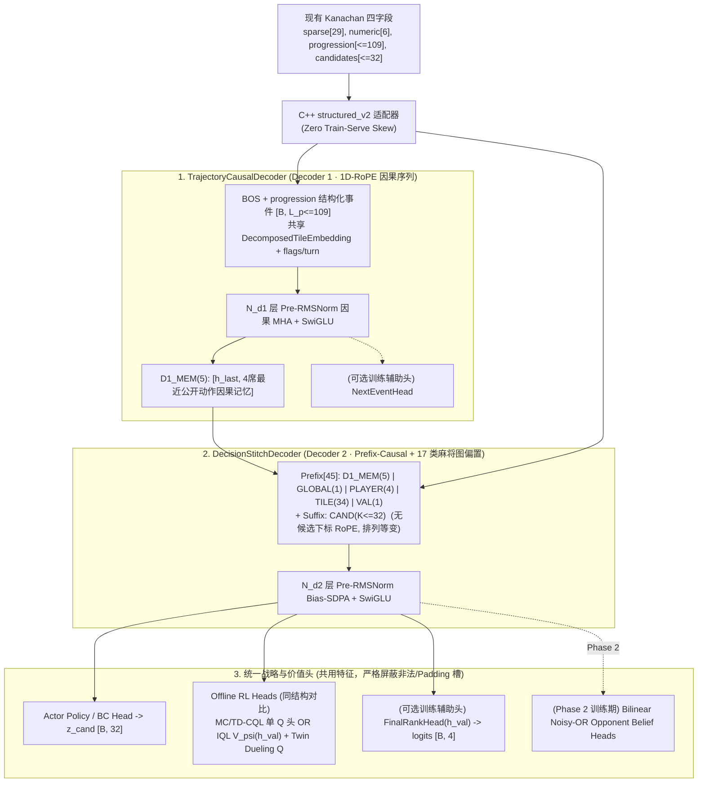

# Structured Dual-Decoder V2 架构与迁移设计文档

> **文档状态**：设计草案（立足 `kanachan` 干净正式基线 `codex/fix-training-stability` @ `28356fe`，分支 `docs/structured-dual-decoder-v2`）  
> **实施边界**：本文档仅定义可验证的架构、适配器、训练目标与迁移契约；不宣称尚未实测的性能或棋力结论。在完成受控功能验证、kernel 基准与同配对局评测前，云端 `source-v3` 现有 Formal `DenseDecisionDecoder` + `MC+CQL` 基线保持独立不变。

---

## 1. 文档定位、基线状态与迁移原则

### 1.1 当前基线状态（`28356fe`）

本分支建立在以下已验证组件之上：

1. **原始雀魂牌谱标注器**：[src/annotation](../../src/annotation/README.md) 原生解析雀魂 WebSocket protobuf 响应，覆盖立直迟延扣棒、抢杠、九种九牌、四风连打、四杠散了、四家立直等四麻规则边界，直接导出 `source-v3` 四字段观战样本与完整半庄终局结果。
2. **原生 C++ 模拟器**：[src/simulation](../../src/simulation/round_state.hpp) 提供雀魂四麻对局仿真与 `kanachan.simulation.simulate` 评测入口。
3. **现有 Formal 模型**：`DenseDecisionDecoder` + `GlobalActionHead`（详见 [decision-decoder.md](decision-decoder.md) 与 [decision-features.md](decision-features.md)），采用 8 层 512 维、147 个展开稀疏/数值/历史 token 拼接 + 全局 546 头 + `discard_afterstate_v1` C++ 46 维弃牌后态分支。
4. **训练与评测底座**：已具备流式 BC、MC＋CQL、TD＋CQL、IQL/AWR 流水线、断点精确恢复（`streaming_mc.py`、`prepared_mc.py`、`episode_replay_buffer.py`）、`dense_final_rank_labels` 以及四座轮换 64 场评测框架。

*(注：本地工作树此前存在未提交且已暂停的 384 维交叉注意力探索稿 `decision-decoder-design-review.md` 与零散试验补丁，为避免混入半成品状态，本设计直接基于干净提交 `28356fe` 独立分支推进。)*

### 1.2 为什么迁移回 `kanachan`，而不是继续修 `RiichiEnv` 重放层

`RiichiEnv` 内部同时维护了在线 `step()`、MJAI 回放 `apply_mjai_event()` 与牌谱对象重放 `apply_log_action()` 三套状态机，且底层依赖 0..135 唯一物理牌 ID，导致读取无物理编号的原始雀魂牌谱时容易在状态机分叉与物理牌去重上反复引入角落规则缺陷。相比之下，`kanachan` 面向雀魂四麻原生建造：

- **规则与牌谱零转译开销**：直接复用 [src/annotation](../../src/annotation/annotation.hpp) 与 [src/simulation](../../src/simulation/round_state.hpp)，彻底避开重放状态机维护包袱；
- **工程落地最短路径**：只把此前设计中被证明高价值的部分——**结构化 34 牌/4 家实体表示 + 拼接式双 Decoder-Only 主干 + 7 模式候选条件表征 + 6× 花色置换增广 / Offline IQL + PBRS / 训练期全视 Belief 监督**——平滑嫁接到 `kanachan` 的训练与原生推理合同上。

### 1.3 两阶段渐进实施边界

- **Phase 1（零重标，100% 兼容现有 `source-v3` 四字段契约与 C++ `simulate`）**：  
  不改动 `source-v3` 数据文件格式，也不改动四字段推理 TensorDict 接口 `("sparse", "numeric", "progression", "candidates")`，通过确定性 C++ 原生特征适配器重建结构化张量并接入新双 Decoder 主干。
- **Phase 2（可选训练期全视标签扩展，不破坏推理接口）**：  
  利用 [Annotation](../../src/annotation/annotation.cpp) 构造时本就持有的四家完整暗手 `std::array<PlayerState, 4u>`，导出独立的训练期全视真值（对手听牌/待牌/瞬时放铳/暗手分布），接通训练期 Bilinear Noisy-OR Belief 辅助监督与可选离线/在线 Oracle Critic；导出 `snapshots/model.kanachan` 时完整剥离，推理侧维持零额外输入、零未来泄漏。

---

## 2. 现有 `kanachan` 四字段契约的无损适配分析（Zero Train-Serve Skew）

本节所有偏移与上界均以 [constants.py](../constants.py)、[features.py](core/features.py)、[player_state.cpp](../../src/annotation/player_state.cpp)、[round_progress.cpp](../../src/annotation/round_progress.cpp)、[annotation.hpp](../../src/annotation/annotation.hpp) 与 [candidate_features.py](../candidate_features.py) 中的实际定义为准。

### 2.1 四字段输入精确布局

| 字段 | 形状与范围 | Padding | 精确编码事实 |
| :--- | :--- | :---: | :--- |
| `sparse` | `int32[B, 29]`，`0..509` | `510` | `[0]` `room (0..4)`、`[1]` `num_rounds_type (+5 -> 5..6)`、`[2..6]` 四席绝对段位 `level (+7/+23/+39/+55)`、`[6]` 观察者绝对席位 `71 + seat (71..74)`、`[7]` `chang (75..77)`、`[8]` `ju (78..81，即庄家绝对席位)`、`[9]` `left_tile_count (82..151)`、`[10..]` 1..5 枚宝牌指示牌 (`152 + slot*37 + tile37`)、暗手张数编码 (`337..472`，`OFFSETS_136`，区分赤 5 与普 5)、可选 `zimo_pai (473 + tile37)` |
| `numeric` | `int32/float[B, 6]` | 无 | `[ben, liqibang, score[0], score[1], score[2], score[3]]`（按**绝对席位 `0..3`** 排列） |
| `progression` | `int32[B, L_p]`，`L_p <= 109` | `2165` | `[0]=0`（局初 BOS；注意 `RoundProgress::onZimo` 注释掉了 `1..4` 自摸事件，实际流仅含公开动作）：`5..596` `DAHAI (seat, tile37, moqie, liqi)`、`597..956` `CHI (owner, chi_encode)`、`957..1436` `PON (owner, relative_from, peng_encode)`、`1437..1880` `DAIMINKAN (owner, relative_from, tile37)`、`1881..2016` `ANKAN (owner, base34)`、`2017..2164` `KAKAN (owner, tile37)` |
| `candidates` | `int32[B, 32]`，`0..545` | `546` | 严格升序合法全局动作 ID：`0..147` Discard/Riichi (`4*tile37 + 2*moqie + liqi`)、`148..181` Ankan (`base34`)、`182..218` Kakan (`tile37`)、`219` Tsumo、`220` Kyushu、`221` Skip/Pass、`222..311` Chi、`312..431` Pon、`432..542` Daiminkan、`543..545` Ron (`from = 0..2`) |

### 2.2 信息可恢复性与 Phase 1 缺口对照表

Strict Train-Serve Skew 控制原则：**如果某信息不能在导出 `model.kanachan` 接管原生 `kanachan.simulation.simulate` 推理时以四字段确定性还原，就绝不进入 Phase 1 模型输入**（例如跨局胜负统计、私密 `SELF_PASS` 历史与他家暗摸均不伪造）。

| 目标特征群 | Phase 1 从四字段恢复方式 | 可恢复性 | 说明与约束 |
| :--- | :--- | :---: | :--- |
| **`tile_feats` 己方与牌效** | `sparse` 手牌/摸牌/宝牌指示牌 + `progression` 已切/鸣走计数 + `Nyanten` 精确向听与扣除可见后有效进张 | **100% 无损** | 沿用 [candidate_features.py](../candidate_features.py) 物理不重复计数规则：`DAIMINKAN` 补齐 3 张同牌、`KAKAN` 仅加 1 张、大明杠/碰/吃不重复计被鸣舍牌；保留赤 5 与普 5 区分 |
| **`tile_feats` 对手公开河牌防卫** | 从 `progression` 无损回放各家 `DAHAI`、`liqi`、吃碰杠、摸切/手切序列，直接计算各家河牌现物、立直宣言后桌显公共现物（不含触发响应的当前未决舍牌）、最近切牌后同巡桌显现物、单/双筋、早巡舍牌提示、手切率与河距离衰减 | **100% 无损** | 注意立直是否**最终被鸣走/放铳成立**：可由下一公开事件及场上 `liqibang` 综合校验；当前 `*_RESP` 窗口的触发牌显式排除在桌显现物之外 |
| **`events` 结构化公共事件流** | 将 `progression[1..109]` 逐条拆解为显式 `(event_type, actor_rel, source_rel, tile37, c0, c1, flags, seq_idx)`；`CHI` 来源固定为上家 (`(owner+3)%4`) | **完全忠实于公开流** | 不包含 `RoundProgress` 未记录的 `DORA` 揭示时刻、`TSUMO_SELF`、`SELF_PASS` 与显式 `REACH_ACCEPTED`（见下行） |
| **`player_feats` 与 `global_feats`** | `numeric[2..6]` 按观察者席位旋转为 `[自, 下, 对, 上]`（保留初始起家下标做同分名次判定）；场风/局数/余牌/宝牌枚数/阶段/触发源相对席位/双立直/一发（由 `progression` 中该家立直至下一次自摸或他家鸣牌间是否有打断确定）均直接由四字段推导 | **本局状态 100% 无损** | **明确缺失（Phase 1 禁用）**：原四字段推理不带跨局 `HanchanTracker`（上局和铳/累计立直率），故 Phase 1 不塞入跨局特征，保证与 `simulate` 零偏差 |
| **`cand_mode` + `cand_dyn` (7 模式)** | `DISCARD` 保留现 C++ 精确向听/进张/振听/有役判断；新增 `CHI/PON` 食替合法后续弃牌包络、杠后已知状态、`PASS` 当前向听/振听、`WIN_EVAL`（公开可见已知番/符，明确扣除本场不双算）、`KYUSHU` 独立评估 | **全部可由公开四字段+Nyanten计算** | 与 Phase 1 前提一致；若含需和了打点精确计算的役种，调用复用 C++ 规则校验器并锁定仅基于可见牌与公开状态 |
| **Opponent Belief / Oracle 标签** | 四家暗手与活山顺序不存在于四字段观战行中 | **Phase 1 缺失 → 留至 Phase 2** | **严禁反推或猜测**；仅在 Phase 2 扩展 `src/annotation` 训练输出新列供给训练期监督 |

### 2.3 原生 C++ 结构化适配器扩展（`structured_v2`）

当前 [candidate_features.cpp](../../src/features/candidate_features.cpp) 已经证明：在 PyTorch/Python 外侧维护与 `Nyanten` 同编的轻量 C++ Python 扩展，既能让训练预取与原生模型推理共用同一份零歧义规则逻辑，又能通过 `SCHEMA_ID` 与 `LRU` 缓存控制开销。

Phase 1 将同一扩展模块从 46 列扩展为版本化 **`structured_v2`** 原生适配器：
1. 输入仍为 `Kanachan` 现有四字段 `(sparse, numeric, progression, candidates)`；
2. 一次 C++ 调用输出五组连续只读紧凑张量：
   - `tile_feats: [B, 34, C_tile]`
   - `global_feats: [B, C_global]`
   - `player_feats: [B, 4, C_player]`
   - `event_tokens: [B, L_p, F_ev]`（由 `progression` 解析的结构化事件元组，`1 <= L_p <= 109`）
   - `cand_mode: [B, 32]` + `cand_dyn: [B, 32, C_cand]`
3. 模型端与数据侧共用同一个只读解析入口并校验 `STRUCTURED_SCHEMA_ID`；**支持在预处理阶段落盘或在线缓存（带 LRU 与输入哈希），但在导出 `model.kanachan` 内保留直接从四字段计算的无状态兜底路径，确保 `simulate` 无需改 C++ 仿真器接口即可运行。**

---

## 3. 模型架构：拼接式双 Decoder-Only（Stitched Dual-Decoder-Only）

### 3.1 为什么选择拼接式双 Decoder-Only，而不是双塔交叉注意力四段式设计

与 `DenseDecisionDecoder`（单序列 147 token 但状态以零散 ID 混合）和此前停滞的四段式重排提案（StateEncoder + HistoryEncoder + StateFusion + ActionDecoder，共 6 次 MHA + 8 次 GQA 小矩阵切换）相比，**拼接式双 Decoder-Only** 的取舍非常明确：

1. **序列短、少切 Kernel**：Decoder 2 总长仅 `45 + K <= 77`，将“历史摘要 + 场况 + 四家 + 34 牌 + 价值 read-out + 最多 32 个候选”放入一次 Prefix-Causal 主干内直接双向/前缀交互，大幅减少交叉注意力之间频繁 launch 小 kernel 的调度开销；
2. **缓存边界干净**：Decoder 1 只消费静态演进的公开 `progression` 事件流，完全不读当前手牌、比分、宝牌与候选列表。在线评估或自对局时，`D1_MEM` 与历史 K/V 按严格前缀严格可缓存；
3. **无位置偏见的候选打分与统一 NULL 编码**：所有 `CAND(K)` 不施加位置 RoPE，且对 `target / consumed0 / consumed1 / source` 引入显式可学习 `NULL_TILE (idx=34)` 与 `NULL_SOURCE (idx=4)` 及 4 维存在性掩码 `has_slot_flags`，546 类动作共用一条无特判、无越界的前向路径；
4. **默认标准 MHA，GQA 只留作可选消融**：在 `L_p <= 109` 尺度下，GQA 节省的 KV 缓存极小，反而可能受 PyTorch SDPA/CUDA kernel 派发约束；因此默认使用标准 MHA（`num_kv_heads == num_heads`），仅将 GQA 保留为对照开关。

### 3.2 模块细节契约

- **共享 `DecomposedTileEmbedding`**：将 `tile37 ∈ [0, 36]` 分解为 `base34` / 花色 `(m,p,s,z)` / 数字 `(1..9,字)` / 是否赤 5 嵌入之和，统一驱动 `TILE(34)`、事件流中的主/消耗牌嵌入以及 `CAND(K)` 的动作关联牌查找。
- **Decoder 1（`TrajectoryCausalDecoder`）**：
  - 输入为索引 0 的强制 BOS 加最多 108 条有效 `progression` 公共事件（长度保证 `>= 1`，绝不因全掩码 softmax 产生 NaN）；
  - 使用 1D-RoPE（FP32 构建正余弦，共享给全部层）、Pre-RMSNorm (`eps=1e-6`)、无 bias `Q/K/V/O` 与 SwiGLU (`Down(SiLU(Gate(x)) * Up(x))`)；
  - 从序列末端与最近 4 席位最后公开动作位置提取 `D1_MEM(5)`。
- **Decoder 2（`DecisionStitchDecoder`）**：
  - 序列布局：`[D1_MEM(5) | GLOBAL(1) | PLAYER(4) | TILE(34) | VAL(1) | CAND(K<=32)]`；
  - Prefix `[0..45)` 内采用**全可见双向注意力**；`[CAND(K)]`（索引 `45..45+K`）可见全 Prefix；候选间是否相互可见（`cand_self_attn: bool = True`）列为显式配置开关以便消融；`~cand_mask` padding query 输出清零且不参与任何 K/V；
  - **17 类可学习麻将图关系偏置 `rel_bias`**（初始化全 0，可通过 `use_rel_bias: bool` 开关与无 bias BF16 FlashAttention/SDPA 路径对比吞吐与收敛）：包含牌与牌（同花色 `±1, ±2, 筋 ±3, ±4`、跨花色同数字、役/三元/风组）、玩家相对方位以及 `CAND` 对其关联 `target / c0 / c1 / source` 节点的有向图连接边。
- **Mode-Routed 7 模式 `cand_dyn`**：通过模态嵌入 + 按 `cand_mode ∈ {0..6}` 路由投影的 `CAND` 特征融合，把弃牌精确后态、副露合法弃牌包络与立直/和了公开可算信息直接送入对应候选 token。

### 3.3 预设规模与精度规范

| 档位 | `d_model / n_heads` | D1 层数 | D2 层数 | SwiGLU 隐宽 | 默认注意力 | 用途定位 |
| :--- | :---: | :---: | :---: | :---: | :---: | :--- |
| **`v2_tiny`** | 192 / 6 | 4 | 2 | 512 | 标准 MHA | 本地 CPU CI、功能合同验证与极速冒烟 |
| **`v2_small`** | 256 / 8 | 6 | 4 | 704 | 标准 MHA | 快速消融实验（对比 `rel_bias` / 增广 / 损失目标） |
| **`v2_base`** | 384 / 8 | 8 | 4 | 1024 | 标准 MHA | 对照 512d `DenseDecisionDecoder` 的主力训练档位 |
| **`v2_large`** | 512 / 8 | 10 | 6 | 1408 | 标准 MHA | 消融验证通过后的高算力放大档位 |

*(实际精确参数量与 RTX 5090 前反向吞吐在 Phase 1B 实例化基准测试后实测记录，不在此处预先估算占位。)*

- **数值精度**：主参数保持 FP32；CUDA 训练可开启 BF16（或 FP16）autocast；动作 logits、期望 V / 动作 Q、softmax、CQL `logsumexp`、Expectile 损失与交叉熵损失**强制升回 FP32**，并在 softmax/均值前通过掩码置零杜绝 `0 * (-inf) = NaN`。
- **优化器约定**：沿用 `DenseDecisionDecoder` 的 AdamW 参数分组：线性层矩阵权重做 weight decay；嵌入层、RMSNorm 缩放、bias、`NULL_*` 向量及 `rel_bias` 关系表不做 weight decay。
- **决胜同分规则**：合法最优动作选取复用 `legal_argmax`，数值完全相等时固定选**全局动作 ID 最小者**，保证候选顺序排列下的动作身份严格不变。

---

## 4. 统一训练与强化学习路线

### 4.1 Stage 1：BC + 可选结构与辅助监督

- 直接接入 `kanachan.training.bc` 与现有已审 `source-v3` 数据流，候选评分头对合法候选执行 masked cross-entropy；
- **可选辅助头与增广（全部设计为严格独立可开关消融）**：
  1. `NextEventHead`：基于 Decoder 1 输出预测下一条公开事件（默认权重 0，开启时处理单事件流 zero-loss DDP 安全）；
  2. `FinalRankHead`：复用现有 `kanachan/training/core/final_rank.py` 的 `dense_final_rank_labels` + `final_rank_loss`，按整条玩家轨迹线性加权 `w_t = reference_steps / T_player` 全局求均，不在 microbatch 内破坏梯度累积与 DDP 等价性；
  3. **6× 花色置换数据增强**：在 `man / pin / sou` 三门花色（$3! = 6$）之间映射手牌、公开事件、宝牌与 546 动作 ID 并按 `global_id` 重新升序排列候选。鉴于“绿一色”等极其罕见的花色非对称情形，该增强显式作为独立布尔开关控制与消融，不假设严格全手牌无例外对称。

### 4.2 Stage 2：Offline RL（IQL + AWR 与 MC+CQL 同主干公平对照）

借助 `kanachan` 已验收的 [cql](cql/train.py)、[iql](iql/train.py)、[awr](awr/train.py) 与 [episode_replay_buffer.py](core/offline_rl/episode_replay_buffer.py) 底座，将 V2 主干同时暴露两种强化学习读出头，在**相同数据、相同参数预算与相同优化步数**下比较：

1. **路径 A（MC＋CQL / TD＋CQL 直接升级对照）**：复用 `GlobalActionHead` 契约，在 `(h_val, h_cand)` 上直接输出合法候选的标量 `action_value`；通过 `bc_initial_model` 复制 Decoder 1/2 主干与隐藏投影层，**标量末层零初始化**，严禁把 BC logits 直接当成回报估值。
2. **路径 B（IQL Expectile $V_\psi$ + Twin Dueling $Q_{\theta_1,\theta_2}$ + AWR）**：
   - 从 `h_val` 读出 $V_\psi(s)$，从 `(h_val, h_cand)` 读出双胞 Dueling $Q_1, Q_2$；
   - 按 `kanachan.training.iql` 契约，IQL 的 Expectile 与 Bellman 目标严格只消费历史日志执行动作（未选动作不进 $V/Q$ 更新），Polyak target 在 DDP 下于 rank 0 同步广播并支持断点续训保留 lag；
   - AWR 策略提取阶段支持以冻结 Stage-1 BC 为可选 KL 锚点；训练结束后只导出纯净 Actor 权重，V/Q 头完全剥离，零额外推理延迟。
3. **可选势能奖励塑造（PBRS）消融**：
   - 支持直接复用 `round_and_placement` / `placement` 作为基准奖励；
   - 同时接入基于**局初纯状态势能函数 $\Phi_k = \sum_{r=1}^4 w_r P_{\text{GRP}}(r \mid s_k, i)$**（可由轻量独立 20 维 MLP GRP 或冻结 `eor2ranking` 在局初校准并冻结 `requires_grad=False`）的严格伸缩塑造回报 $r_k = \Phi_{k+1} - \Phi_k$（跳过无决策小局时自动合并差分至上一有效决策步，总和恒等 $\sum r_k = R_{\text{term}} - \Phi_0$），作为独立变量与默认奖励公平对比。

### 4.3 Phase 2 扩展：C++ `src/annotation` 训练期全视标签（Belief / Oracle Critic）

在 Phase 1 验证新主干优于旧 `DenseDecisionDecoder` 后，再启动 Phase 2（不阻塞 Phase 1 上线）：

- 在 `src/annotation` 独立生成版本化额外监督文件（或新增字段），导出每步的三家真实听牌 `opp_tenpai[3]`、真实待牌 `opp_waits[3, 34]`、当前河/手瞬时放铳真值 `exact_dealin_now[34]` 及三家暗手分布；
- Actor 端接入训练期专用的 `Bilinear Noisy-OR Belief Heads` 联合训练共享表征，导出时完全裁剪；
- 为可选 Stage 3（独立小尺寸 `OracleCriticV2` + `CriticWarmupGate` + `PFSPOpponentPool` 自博弈微调）预留清晰接口，Actor 与 Critic 之间仅共享可观测张量、绝不共享动态隐藏层。

---

## 5. 检查点契约、原生导出与缓存一致性

1. **新架构与 Schema 强绑定**：
   - 定义新常量 `ARCHITECTURE_ID = "mahjong_structured_dual_decoder_v2"` 与独立 config preset（如 `encoder=structured_dual_v2`），绝不复用 `"mahjong_dense_block_decoder_v1"` 的构造分支或混用旧优化器/回放检查点；
   - 检查点签名绑定：`ARCHITECTURE_ID`、`STRUCTURED_SCHEMA_ID`（含 C++ `src/features` 实现摘要）、各模块超参（`d_model`, `n_heads`, `n_d1`, `n_d2`, `use_rel_bias`, `cand_self_attn`）、奖励与损失配方、训练数据 SHA256 与 RNG 状态；任一契约不匹配均 Fail-Closed 拒绝恢复。
2. **双模式推理与原生 `simulate` 兼容性**：
   - **默认无状态导出路径（用于 `kanachan.simulation.simulate`）**：导出为兼容现有四字段 TensorDict 输入的 portable checkpoint，每次前向完整走完 C++ 适配器 + D1 + D2，不跨 batch 槽位复用缓存，避免四字段批处理缺少全局对局身份造成的串台；
   - **显式有状态 KV-Cache 路径**：复用现有 `DecisionContext(environment, game, seat, round_instance, model_version)` 协议，仅缓存 Decoder 1 针对 `progression` 公共事件前缀的 K/V 与前缀 ID；前缀回退、换局（含本场变更）、权重/设备变更时强制清空重建，必须通过与无状态全序前向数值一致校验。

---

## 6. 分阶段实施计划与 Go / No-Go 验证门控

### 6.1 分阶段里程碑

| 阶段 | 交付内容 | 前置门控（Gate） |
| :--- | :--- | :--- |
| **Phase 0（已完成）** | 立足干净基线 `28356fe` 创建独立分支并冻结设计规格 | 设计审阅定稿，旧基线代码零污染 |
| **Phase 1A** | C++ `src/features` 升级为 `structured_v2` + Python 参考对齐 | 四字段往返、吃碰杠/加杠计数守恒、桌显现物时序隔离、7 模式候选特征全部单测通过 |
| **Phase 1B** | PyTorch `StructuredDualDecoder` + 四字段导出 + IQL/CQL 接入 | 零泄漏、候选排列等变、Padding 无 NaN、因果/KV-Cache 等价、Python 与原生 `simulate` 逐动作一致、中断续训精准恢复、RTX 5090 BF16 kernel/吞吐实测 |
| **Phase 1C** | 受控离线训练与原生对局对照评测 | 按下方三组极简对照在固定独立全牌谱验证集 + 配对种子四座轮换对局中完成统计检验 |
| **Phase 2（可选）** | 扩展 `src/annotation` 导出四家暗手训练真值并接入 Belief / Stage-3 自博弈 | 仅在 Phase 1C 验证结构净收益成立后按独立数据版本启动 |

### 6.2 上 GPU 前必须全部通过的功能合同矩阵

1. **Zero Leakage**：篡改未见未来历史或非可见槽位，当前步前向输出不变；
2. **Candidate Permutation Equivariance**：打乱合法候选输入排列时，对应动作 logits / Q 值严格随候选同步重排，且 `legal_argmax` 选出同一物理动作（含同分 tie-break）；
3. **Padding & Mask Safety**：`cand_mask=False` 槽位与空历史边界不参与 BC CE、CQL `logsumexp` 与均值归一，零 `0 * (-inf) = NaN`；
4. **Causality & KV-Cache Parity**：修改未来事件不改变早期 Decoder 1 表示；增量 `KVCache` 与无缓存全前向在 FP32/BF16 允许误差内一致，且 `kanachan.simulation.simulate` 与 Python 侧选动作完全一致；
5. **GPU Kernel Check**：在目标训练 GPU（如 RTX 5090 BF16）实测开启/关闭 `rel_bias` 时的实际 SDPA backend 派发、steps/sec 吞吐与显存峰值，禁止基于 CPU 推理速度做未经实测的 GPU 性能外推。

### 6.3 最小 3 组干净对照实验（禁止混杂变量）

所有正式比较必须共享固定整局划分的 train/val/test（同配对种子、四座轮换，同时报告一位率、平均顺位、四位率及其分组置信区间）：

1. **实验 1（纯架构对比）**：在**相同 `source-v3` 数据、相同 BC 目标、可比计算预算**下，对比现有 512d `DenseDecisionDecoder + discard_v1` 基线 vs `StructuredDualDecoder (v2_base)`（关闭额外增广与辅助头）；
2. **实验 2（结构消融：仅调结构）**：基于 `v2_small` 比较 `use_rel_bias=True/False` 与 `cand_self_attn=True/False`（含 BF16 实测吞吐与验证 NLL 权衡），剔除无净增益的冗余偏置或自注意力；
3. **实验 3（Offline RL 目标与数据增强对比）**：固定最优 BC 主干，在同预算下比较 **MC＋CQL vs IQL＋AWR**，以及**6× 花色置换增广 / PBRS 势能奖励**各自独立开启的净收益。
